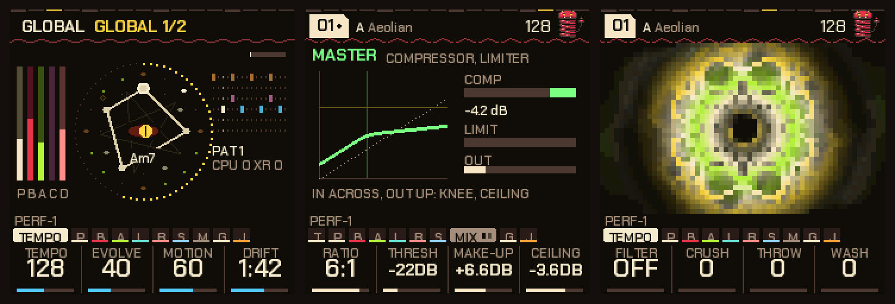
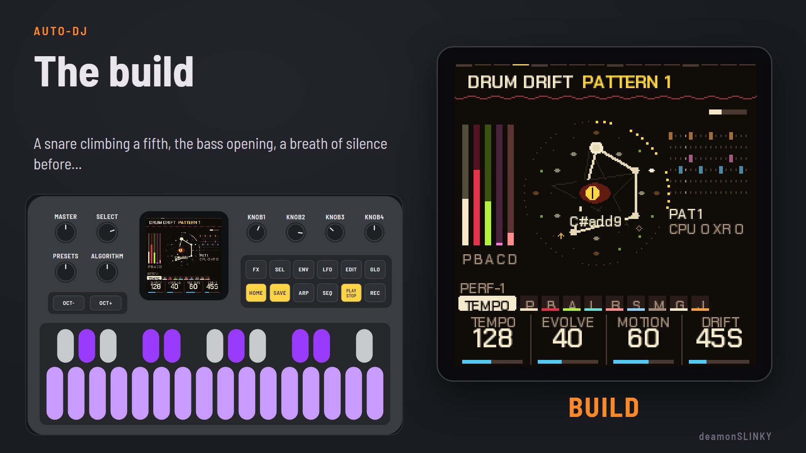
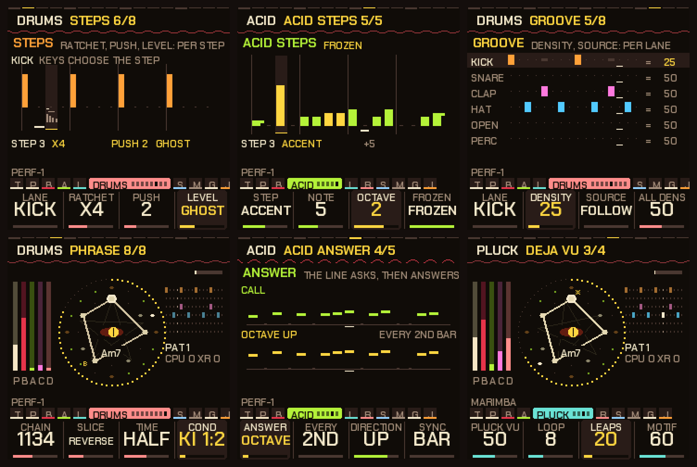
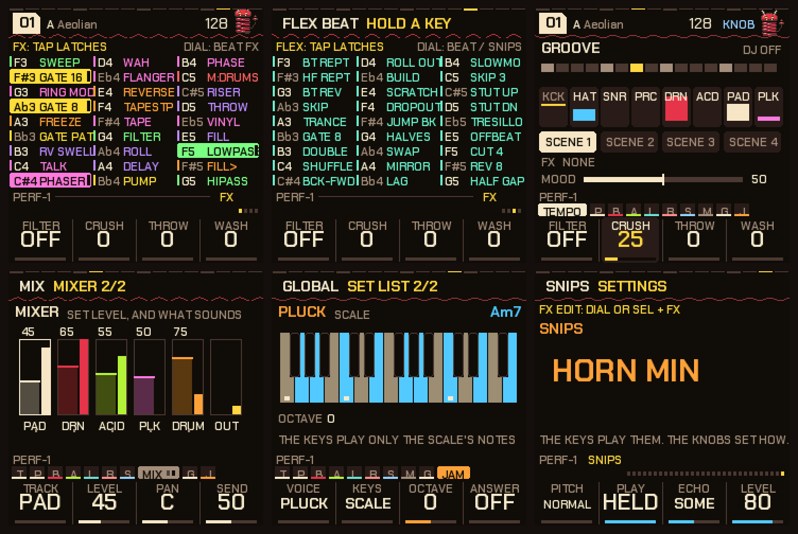
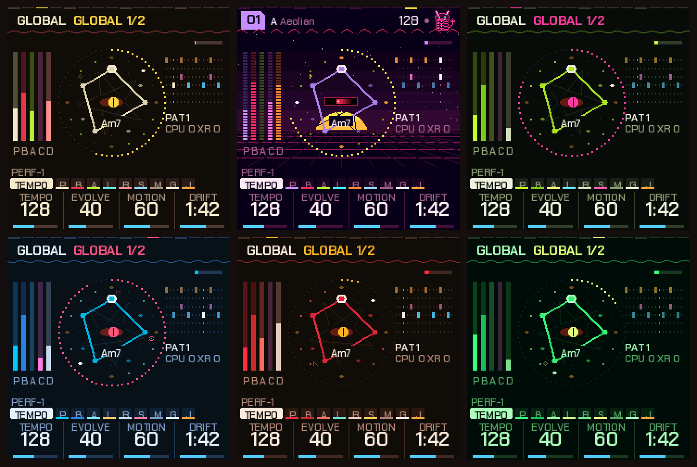

# NAIWAN 91

**内湾 (NAIWAN) 91 — city pop and coastal firmware for the M-VAVE FM-1.** Nineteen genres that play themselves while you steer:
ten urban (city pop, AOR, boogie, shibuya-kei, yacht rock and more) and nine coastal (surf, balearic, tropic,
summer, marina, calypso, island, seaside, sands), each a set of ten jam pieces in the vein of the late-70s /
early-80s records the genre is named for, played on the firmware's own FM, analog and percussion engines. A honu
turns behind the chord figure, sea glyphs flare on the pluck, and the whole thing runs in the browser as
WebAssembly.

*The home screen, the master bus and a visualizer.*

**Try it now:** <https://superposition.github.io/91/emu/> — the browser emulator runs the same code with sound.
The installer, editor and manual are on the same site: <https://superposition.github.io/91/>.

*The Perform screen, the auto-DJ's build, the effects and the genre sets.*

## DX7 Citypop Songbook (0.3.0 local build)

Three original Harris-informed Citypop songs provide 32/64-bar forms from 8/16-bar sections, with a stable home key, voice-led sixth/diminished chords, independent DX keys and bass, and phrase-timed swells. PRESETS chooses songs; SELECT opens Arrangement, DX Keys, DX Bass and Swells. The four main knobs control key, tempo, section length and activity. F3 holds a section, G3 requests a related idea, and F4 returns to the legacy instrument.

[Songbook and Jam Packs](docs/JAM_PACKS.md) documents controls, musical data, MIDI/DX voice import and USB updates. Songs and up to eight embedded DX programs can be auditioned and saved to four slots without another firmware rewrite. V1 packs and all legacy parameter indices remain supported. The [fm1-jam skill](skills/fm1-jam/SKILL.md) uses the same CLI. These local changes have not been deployed to the public links above.

[Local validation](docs/SONGBOOK_VALIDATION.md) records the ten-minute FM-1 test, saved-pack restart check and existing baseline test failures.

## Rust migration in progress

The local browser build runs Songbook planning, bass decisions and pack/session codecs in Rust, with the existing C synthesis and UI. [Architecture, layouts and reproduction commands](docs/RUST_MIGRATION.md) document the port and Friday talk evidence. The [migration epic and 25 tickets](https://github.com/superposition/91/issues/1) track the remaining work. This incremental emulator build is not a new physical-device release.

## What's in 0.1.0

**Nineteen genres, one mechanism.** Every genre is a donor column of the engine's library plus its own ten
tempo / root / mode rows, its own answer on top of the donor's recipe, and its own five pluck sounds. Adding a
genre is one row in each of those tables; there are no per-genre copies of the drum patterns, the chord habits
or the section profiles.

- **Urban:** CITYPOP (104), SUNSET (106), AOR (96), SHIBUYA (118), BOOGIE (116), YACHT (88), TAPE (96),
  NEON (112), KAYO (76), LOUNGE (92).
- **Coastal:** SURF (140), BALEAR (100), TROPIC (112), SUMMER (108), MARINA (96), CALYPSO (124), ISLAND (80),
  SEASIDE (118), SANDS (72).

**Sea iconography.** The home screen's rotating star is a **honu** — shell, three scutes, four flippers, head and
tail — and the glyphs that flare on each plucked note are a scallop, a starfish, a fish, a turtle, a jellyfish, the
sun, an anchor and a palm. The chord figure, the phrase ring, the bar ring and the section-reading eye stay.

**One piece per mode.** No two pieces of a genre share a pad, a mode and a chord kind, so a set of ten sounds like
ten pieces rather than five played twice; the twins audit runs clean at its threshold.

## What it is

NAIWAN 91 is a custom firmware for the M-VAVE FM-1: a 5 track generative groovebox you perform on. You don't write a
song and press play: you pick a piece, and it plays (a pad, a bass, a 303-style acid line, a pluck, drums), and you
shape it live: break it down, build it back up, drop it, mute and solo parts, throw effects, change the pattern, take
the acid somewhere else. Everything is changeable while it plays, and nothing is a loop of audio: the notes are
generated by the engine on the FM-1 itself, from the key, the scale and the chord it is in. Auto-DJ can run the whole
arc (groove, fill, breakdown, build, drop) by itself while you change the Mood.

## Who it's for

- **If you want to make music without first learning how to build a good song,** NAIWAN 91 is a place to start.
  Every piece already sounds finished: choose a genre, press play, and you are performing from the first minute,
  steering a groove that holds together (the chords, the drums, the acid and the effects all follow the same key and
  tempo). You learn by turning things, not by programming them.
- **If you already know what you want,** it opens up. The sequencer, the sound pages, the acid line, the scales and
  the effects can be edited as deeply as you like, a piece you have shaped can be stored, and your own DX7 voices can
  be loaded.

## What makes it different

- **Pieces that evolve.** Each piece is a set of rules (key, mode, tempo, which sounds, which drum patterns), not a
  recording. The chords move, the acid line mutates a little each time round, the pad breathes, the hats change.
  Leave it alone and it develops; touch it and it follows you.
- **A performance instrument, not a preset player.** One button breaks the music down, a second builds it, a third
  drops it. An **auto-DJ** can run the whole arc by itself and bring in the next piece. Scenes store your mix and
  effects and recall them on the bar. Effects are played like keys, in four banks (27 effects, 24 beat FX, 15 flex
  beats and 27 DJ snips, 93 keys in all): tap to latch, hold to play. A **Mood** dial moves a dozen settings at once
  from chill to peak.
- **Genres that behave like genres.** Each brings its own tempos, swing, drum kits and patterns, its own effects, its
  own bass habit, its own pad comping and ghost notes, and its own habits for where the chords go next. Ten pieces
  each, a hundred and ninety in all.
- **A real sequencer under the generator.** Six drum lanes, sixteen steps, six patterns. Euclidean fills and
  rotation, a chance per lane, lanes with their own lengths (polymeter), a **density** control that thins a lane by
  importance, a **source** per lane, pattern keys that play only while held, and **drum drift**: patterns that change
  and mutate on their own, with the backbeat protected. Per step, **ratchets** (x2 to x6, flams, swells), **push**
  and **level**; over bars, **chains** of patterns, **slice** permutations, half and double time, and a **condition**
  for each lane.
- **The acid answers itself.** The line asks, then answers: an octave or a fifth up or down, a third within the
  scale, the contour mirrored, backwards, shifted a beat, thinned, or reduced to its accents. Like the line?
  **Freeze** it and edit it as sixteen steps.
- **Effects you edit, not only throw.** Every effect with settings has a page that draws it: the gate's steps, the
  roll's speed-up, the scratch, the freeze, the phaser, the tape, the vinyl, the pump's targets.
- **A mixer and a real master bus.** A live meter and fader for every layer and the output, pan and sends per layer;
  behind it a stereo-linked compressor and a look-ahead brick-wall limiter, each genre bringing its own settings and
  the screen drawing them as they work.
- **Jam along.** The Jam page makes the 27 keys an instrument: every key a note of the scale, triads, or a harp up
  the scale, over the music as it plays; stop, and the pluck can answer your phrase back an octave up.
- **Real FM voices, and yours.** A six-operator FM engine plays 30 DX7-style voices as the pluck, and you can load
  up to 16 of your own DX7 voices from a `.syx` file over USB. A browser **editor** shows every parameter and edits
  DX7 voices with a live preview on the unit.
- **You keep what you make.** Any piece can be stored; the unit remembers your theme, tuning, effect settings and
  DX7 voices across power-off, and the installer page backs all of it up to a file and restores it.
- **Five tracks at once, with a safety net.** The engine is built around not breaking: a second core takes the
  reverb and, under load, more of the work; a master bus keeps the sum from clipping; and a piece that gets too heavy
  sheds the least important work before it would drop a sample.

*Under the generator: ratchets, push and level per step; the acid line frozen into steps; density and source per drum
lane; chains, slices and half or double time; what the acid answers; the pluck remembering its phrase.*

*Playing it: the FX menu (latch or hold), the Flex Beat bank, the Perform screen, the mixer, the Jam page and the DJ
snips.*

## A first minute

1. Switch on: the boot cards play and a piece starts by itself. Any key skips the cards.
2. Turn **SELECT** to walk the pages; the four knobs under the screen change what each page shows. Turn **PRESETS**
   for another piece; hold **GLO** and turn **PRESETS** for another genre.
3. Tap **SAVE** for a breakdown on the next bar, tap it again for a build and the drop.
4. Press **FX**: tap a key to latch an effect, hold it to play it. Hold **GLO** for the mute and solo map and the
   scenes.
5. Hold **SEQ** for the step sequencer; the white keys are the sixteen steps.
6. **GLO**, then **SAVE** stores the piece you are in.

The manual ([docs/MANUAL.md](docs/MANUAL.md), or the page on the site with screenshots) covers every control and page.

## The look

The screen is drawn in one look (warm black, one colour per voice: the pad bone, the bass crimson, the acid lime,
the pluck ice-teal, the drums pink) in six palettes, chosen on the Global page.

## Install

Use the web installer, <https://superposition.github.io/91/install/>, in Chrome or Edge with the FM-1 plugged in.
**Installing firmware is at your own risk.** The installer checks the package against the unit, can put M-VAVE's own
firmware back, and an FM-1 that fails to start twice comes up in a safe mode the installer can reach. Read section 1
of the manual first, and keep a way to restore the stock firmware to hand. NAIWAN 91 keeps its own pieces, settings
and DX7 voices and does not read the projects or samples of other firmwares; what is stored may be lost when you
switch either way, so keep copies of anything you care about. `BUILDING.md` ends with what the install does and does
not protect against.

## Under the hood

- **Hardware:** JieLi AC79 (pi32v2 core, two cores at 240 MHz, a single-precision FPU, 512 KB of RAM, code run in
  place from flash), 44.1 kHz stereo, the screen drawn in three bands over DMA.
- **Audio:** the whole instrument renders in 5.8 ms chunks (an 11.6 ms budget for two); the plate reverb, and under
  load more of the work, runs on the second core and is checked for identical output either way; a master bus with a
  compressor and a look-ahead limiter; a six-operator FM engine on integer buses.
- **Genres:** one library of 15 donor columns (recipe, drum patterns, harmony and section tables) and 19 genre rows
  over it: a donor index, ten tempo / root / mode rows, a recipe delta list and five pluck sounds. Play, patterns,
  names and palettes all resolve through that mapping, so a genre is data, not code.
- **Storage:** every genre has its own flash object (A/B sectors with a commit record, so a power cut keeps the
  previous copy), holding packed 376-byte piece records with room to grow.
- **Tests:** about 70 scripted scenarios run the whole app in a simulator (`tests/`), alongside tests of the maths,
  the instrument, the flash code, the SysEx protocol and the editor; a genre-pair audit checks that no two pieces of
  a genre are too alike.
- **Source layout and the build:** `BUILDING.md`. **Version history:** `docs/CHANGELOG.md`.

## Feedback, ideas and help

Comments, suggestions, ideas and bug reports are welcome: [open an issue](https://github.com/superposition/91/issues).
A bug report is most useful with the version (shown on the boot card), the genre and piece, and, for anything about
load or crackles, a status log (`tools/fm1log.py`, or the "Live status" on the installer page). Code, documentation
and sound-design contributions are welcome too: see `CONTRIBUTING.md`.

## Credits and licence

NAIWAN 91 is a fork of **PERF-1** v0.17.0 by deamonSLINKY (GPL-3.0), the lineage and licence staying with it: PERF-1
is a fork of **HYP-1** by [RedtailWorks](https://www.redtail.works), itself a fork of **AMB-1** by Charles Vestal,
built on the platform layer of **Felucca** by Leo Kuroshita (Hügelton Instruments) through X0X and FoMni. The
six-operator FM engine that plays the DX7 voices, its factory voices and the second-core work are from **Melodee** by
Kerem Kilic (Ellic Studio); its synthesis is after **Dexed** by Pascal Gauthier, on MSFA by Raph Levien (Google).
Several generator ideas (bass line modes, pad comping, ghost notes, the pluck's deja vu loop) follow **Tuna** by
delirioux ([github.com/delirioux/tuna](https://github.com/delirioux/tuna), GPL-3.0), written afresh for this engine.
The reverb is Jon Dattorro's plate ("Effect Design, Part 1", JAES 1997). The git history keeps every author's
commits. The idea of a browser emulator for FM-1 firmware comes from Groove OS by Peter Gombos (no code taken). The
community reverse-engineering of the chip, [AL-255/FM-1-RE](https://github.com/AL-255/FM-1-RE), informed the hardware
work, and the rescue route uses FM-1-transporter's protocol and kagaimiq's jl-uboot-tool.

GPL-3.0-only (`LICENSE`); the code's origins and the third-party material (fonts, the JieLi SDK) are in
`LICENSING.md`. "M-VAVE" and "FM-1" are trademarks of their owners; NAIWAN 91 is independent firmware, not affiliated
with or endorsed by them.
