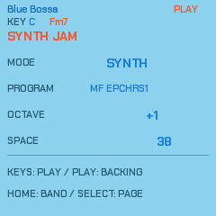

# NAIWAN 91

**A city-pop band to play along with, in your browser or on the M-VAVE FM-1.**

Choose **Blue Bossa**, **Autumn Leaves** or **Satin Doll**, find your key, and play along. Give the changes a warm electric piano, a bright brass sound or a soft pad. Add a rounded bass, hold a section you like, and change the feel while you keep playing.

Want to take the keyboard part yourself? **Synth Jam** puts the sound under your fingers while the drums and bass carry on. Play chords, trade lines with the bass, change the sound or add more space, then bring the band back without restarting the song.

*Blue Bossa in the 0.4.4 browser player. These five captures come from the current instrument's framebuffer.*

[Play in your browser](https://superposition.github.io/91/emu/) · [Songbook guide](docs/JAM_PACKS.md) · [Controls and manual](docs/MANUAL.md)

Press **Switch on** to start the browser player. Use your mouse, touch screen or keyboard; an FM-1 is optional. Updates on this branch may not be on the published site yet.

## Find your sound

- **Choose a standard.** Turn PRESETS for Blue Bossa, Autumn Leaves or Satin Doll, then set a comfortable key and tempo. The written changes stay intact as the accompaniment plays.
- **Shape the band.** Each song has six keyboard sounds and two bass sounds. Change programs, lift the keys an octave or drop the bass lower, and adjust the reverb as you play.
- **Take the keys.** Open Synth Jam with SELECT and turn MODE to SYNTH. All 27 piano keys play notes; PLAY starts or stops the backing. HOME brings the band back.
- **Stay with a phrase.** REC holds the current section; EDIT asks for a new bass motif. In Band mode, the F3 and G3 piano keys do the same.
- **Change the feel.** Choose close or drop-2 chords, try another inversion, or change the bass feel. These controls keep the song's harmony.
- **Explore further.** In Band mode, the F4 piano key opens generative pieces, sequencers, effects and visualizers. The [manual](docs/MANUAL.md) explains their controls.

## Shape the song

 

 

SELECT opens Arrangement, DX Keys, DX Bass and Synth Jam. Each page has four matching controls, from top to bottom. On DX Keys and DX Bass, knob 2 sets that part's octave independently, from −2 to +2. The packs start with both parts one octave up and a spacious plate reverb, leaving the bass line clear enough to play against.

Synth Jam's four knobs are **Mode, Program, Octave and Space**. Switch between automatic keyboard accompaniment and your own playing, using the song's existing sounds. You can play with the backing stopped too. HOME releases the notes you were holding and returns to Band mode without resetting the chart or groove.

## Make it yours

Keep your songs and sounds in packs. Alongside the three factory songs, the repository includes four more arrangements to load into the four user slots: **Blue Bossa Deep**, **Leaves Drawbars**, **Satin Muted Guitar** and **Major Minor Lab**. Across the seven packs there are 30 custom instrument programs, with sound-designer credits and source banks retained.

Write your own chord chart, choose a sound template and generate its accompaniment. On an FM-1, save up to four packs and come back to them without a computer. Stop playback before saving your session settings. The [Songbook guide](docs/JAM_PACKS.md) covers chart import, choosing programs, creating packs and saving your changes.

If you have an FM-1, the [installer](web/amb_installer.html) includes backup and recovery tools. The [editor](web/editor/) adjusts the connected instrument's legacy parameters and DX voices; use the Songbook pages and pack tools for these arrangements. Read the [install instructions](BUILDING.md) before updating your instrument.

## Development

For building and contributing, see the [build instructions](BUILDING.md), [contributor guide](CONTRIBUTING.md) and [development notes](docs/RUST_MIGRATION.md). The [0.4.4 integration record](docs/RELEASE_0_4_4.md) separates source changes, automated checks and hardware qualification; [0.4.3](docs/RELEASE_0_4_3.md) records the preceding source-preservation checkpoint. Screenshot provenance is kept with the [web documentation](docs/WEB_REFACTOR.md).

## Credits and licence

NAIWAN 91 is a fork of **PERF-1** v0.17.0 by deamonSLINKY (GPL-3.0), the lineage and licence staying with it: PERF-1
is a fork of **HYP-1** by [RedtailWorks](https://www.redtail.works), itself a fork of **AMB-1** by Charles Vestal,
built on the platform layer of **Felucca** by Leo Kuroshita (Hügelton Instruments) through X0X and FoMni. The
six-operator FM engine that plays the DX7 voices, its factory voices and the second-core work are from **Melodee** by
Kerem Kilic (Ellic Studio); its synthesis is after **Dexed** by Pascal Gauthier, on MSFA by Raph Levien (Google).
Several generator ideas (bass line modes, pad comping, ghost notes, the pluck's deja vu loop) follow **Tuna** by
delirioux ([github.com/delirioux/tuna](https://github.com/delirioux/tuna), GPL-3.0), written afresh for this engine.
The reverb is Jon Dattorro's plate ("Effect Design, Part 1", JAES 1997). The git history keeps every author's
commits. The idea of a browser emulator for FM-1 firmware comes from Groove OS by Peter Gombos (no code taken). The
community reverse-engineering of the chip, [AL-255/FM-1-RE](https://github.com/AL-255/FM-1-RE), informed the hardware
work, and the rescue route uses FM-1-transporter's protocol and kagaimiq's jl-uboot-tool.

GPL-3.0-only (`LICENSE`); the code's origins and the third-party material (fonts, the JieLi SDK) are in
`LICENSING.md`. "M-VAVE" and "FM-1" are trademarks of their owners; NAIWAN 91 is independent firmware, not affiliated
with or endorsed by them.
