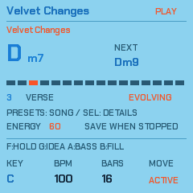
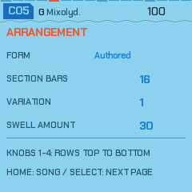
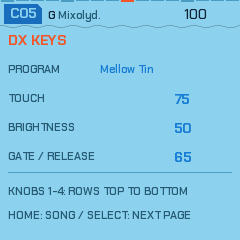
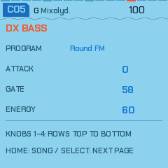
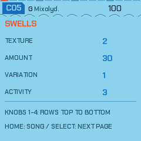

# NAIWAN 91

**A city-pop Songbook for the M-VAVE FM-1, with an incremental migration to Rust.**

Play alongside three original arrangements: **Velvet Changes**, **Afterhours** and **Neon Turnaround**. Each keeps a home key while voice-led sixth/diminished harmony, independent DX keys and bass, and phrase-timed swells make room for a live instrument. Steer the band with the panel, mouse, touch or keyboard.

<p align="center"></p>

*The current Songbook performance screen, captured from the WASM instrument.*

[Try the published emulator](https://superposition.github.io/91/emu/) · [Current migration draft](https://github.com/superposition/91/pull/27) · [Architecture and evidence](docs/RUST_MIGRATION.md) · [Songbook guide](docs/JAM_PACKS.md)

The browser emulator needs no FM-1. Audio starts only after **Switch on**. The published site can lag this working branch; the current Rust and web refactor are tracked separately from a hardware release.

## The instrument now

- **Three authored songs.** 8/16-bar sections combine into 32/64-bar forms, with major/minor realizations, written destinations and a stable home key.
- **Independent DX roles.** Keys and bass have their own programs, touch/attack, gate and release. Swells follow the phrase rather than a free-running pad cycle.
- **Performance controls.** PRESETS chooses a song. The main knobs set key, tempo, section length and movement; ALGORITHM sets energy. F3 / REC holds a phrase; G3 / EDIT asks for a related idea.
- **Editable packs.** Songs and up to eight embedded DX programs can be auditioned and kept in four slots without another firmware rewrite. Session settings save while playback is stopped.
- **A retained legacy instrument.** F4 opens the existing generative pieces, sequencers, effects and visualizers. Their controls remain documented in the [manual](docs/MANUAL.md).

## Current screens

These are fresh captures of the actual Songbook framebuffer, rather than screenshots inherited from the earlier fork.

<p align="center"> </p>
<p align="center"> </p>

SELECT opens Arrangement, DX Keys, DX Bass and Swells. Each page has four matching controls, from top to bottom. HOME returns to the Songbook performance page.

Regenerate these images with `node tools/capture_web_screens.mjs build/emu/amb.wasm`. [Capture metadata](docs/img/naiwan91-captures.json) records the WASM hash, seed and image hashes. These captures establish instrument screens; browser layout inspection is a separate check.

## Rust migration

The emulator integrates shared `no_std` Rust libraries for compact musical types, Jam Pack/session codecs, deterministic phrase planning, bass decisions and command queue ownership. The existing C application, command dispatch, transport, synthesis, effects and screen UI remain in use during the port.

The [migration epic and 25 tickets](https://github.com/superposition/91/issues/1) cover the complete conversion. The final ticket, [How I did it](https://github.com/superposition/91/issues/26), builds the engineering talk from measured decisions and reproducible demos. The [web refactor](docs/WEB_REFACTOR.md) keeps the site, product language and imagery aligned with that work.

| Representation | Size |
| --- | ---: |
| Six patterns × six lane masks | 72 bytes |
| 1,024 packed command words | 4,096 bytes |
| One phrase / two phrase buffers | 388 / 776 bytes |
| Stored Songbook session | 20 bytes |

The integrated checkpoint compares **34,730,900 Float32 audio values** with the C reference, including Hold, New Idea, Save, restart and irregular render sizes. All values match, with zero C fallbacks and no WASM memory growth. [Exact evidence and limitations](docs/rust/emulator-proof.json) are retained. This proves the delivered browser slice; physical Rust execution and the full conversion remain open.

```sh
cargo test --workspace --locked
cargo clippy --workspace --all-targets --locked -- -D warnings
cargo run -p fm1-cli -- layouts
cargo run -p fm1-cli -- validate packs/velvet-changes.jmp
cargo run -p fm1-cli -- plan packs/velvet-changes.jmp 6 1 8
sh tests/rust_emulator_parity.sh
```

The broad original baseline has **100 passing and 22 failing checks**, recorded before the port. The migration comparisons preserve those fingerprints; they do not turn a known baseline failure into a passing result.

## Browser and hardware

The [emulator](web/emu/) uses the real instrument compiled to WebAssembly, with a thin browser audio/input/storage layer. AudioWorklet is used on secure origins; a compatible Web Audio callback keeps local-network HTTP previews usable. MIDI controllers are optional. The [web editor](web/editor/) and [installer](web/amb_installer.html) require a connected FM-1 for their device operations.

The hardware Songbook checkpoint is version **0.3.0**. Its [physical validation](docs/SONGBOOK_VALIDATION.md) records the ten-minute USB recording, saved-pack restart and resource measurements. The Rust browser checkpoint is not a new qualified hardware release.

- [Build and install instructions](BUILDING.md)
- [Songbook packs, controls and MIDI/DX imports](docs/JAM_PACKS.md)
- [Architecture, unsafe boundaries and compiler investigation](docs/RUST_MIGRATION.md)
- [Contributing](CONTRIBUTING.md) · [Issues and ideas](https://github.com/superposition/91/issues)

## Credits and licence

NAIWAN 91 is a fork of **PERF-1** v0.17.0 by deamonSLINKY (GPL-3.0), the lineage and licence staying with it: PERF-1
is a fork of **HYP-1** by [RedtailWorks](https://www.redtail.works), itself a fork of **AMB-1** by Charles Vestal,
built on the platform layer of **Felucca** by Leo Kuroshita (Hügelton Instruments) through X0X and FoMni. The
six-operator FM engine that plays the DX7 voices, its factory voices and the second-core work are from **Melodee** by
Kerem Kilic (Ellic Studio); its synthesis is after **Dexed** by Pascal Gauthier, on MSFA by Raph Levien (Google).
Several generator ideas (bass line modes, pad comping, ghost notes, the pluck's deja vu loop) follow **Tuna** by
delirioux ([github.com/delirioux/tuna](https://github.com/delirioux/tuna), GPL-3.0), written afresh for this engine.
The reverb is Jon Dattorro's plate ("Effect Design, Part 1", JAES 1997). The git history keeps every author's
commits. The idea of a browser emulator for FM-1 firmware comes from Groove OS by Peter Gombos (no code taken). The
community reverse-engineering of the chip, [AL-255/FM-1-RE](https://github.com/AL-255/FM-1-RE), informed the hardware
work, and the rescue route uses FM-1-transporter's protocol and kagaimiq's jl-uboot-tool.

GPL-3.0-only (`LICENSE`); the code's origins and the third-party material (fonts, the JieLi SDK) are in
`LICENSING.md`. "M-VAVE" and "FM-1" are trademarks of their owners; NAIWAN 91 is independent firmware, not affiliated
with or endorsed by them.
