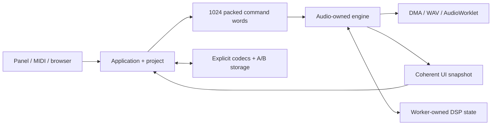
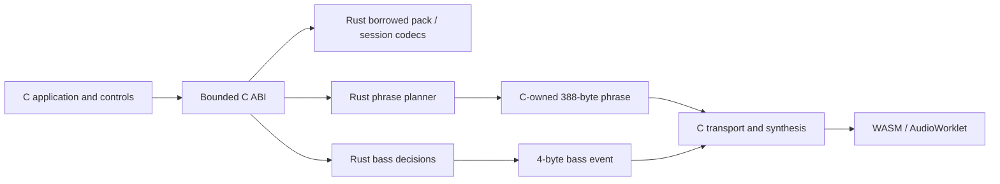

# NAIWAN 91 Rust migration

Execution is tracked in [epic #1](https://github.com/superposition/91/issues/1). Its 25 tickets cover the complete owned firmware, simulator, browser, tools and media code. The last ticket is [How I did it](https://github.com/superposition/91/issues/26), the evidence-based Friday talk.

## Compatibility and ownership

The browser build now runs Rust command publication/consumption, Songbook validation, session encoding/validation, phrase planning and bass decisions inside the existing instrument. Command dispatch, synthesis, application state, transport and UI remain C. The physical firmware still uses its original C path. The current working-tree Songbook/DX7 changes are part of the baseline. Do not reset them to the Git HEAD baseline.

The device uses 256-frame render calls and 512-frame DMA halves at 44.1 kHz, allowing approximately 11,609 microseconds per half. Ordinary RAM is limited to 98,304 bytes, and the 344,064-byte pool must retain 4,096 bytes of reserve.

The target Rust design assigns one owner to each mutable subsystem. The command ring now has Rust producer/consumer endpoints; the render/application owners and coherent UI snapshot have not migrated yet:



Musical/format/type libraries use `no_std`, forbid unsafe code, and have no dependencies on an allocator or browser APIs. The separate `fm1-rt` queue owns a reviewed `UnsafeCell`/atomic publication boundary. Native tools use `std`. Hardware and foreign-function boundaries have separate safety invariants; `volatile` does not establish thread synchronization.

The agreed upstream exception is the recovery stub: version **3**, SHA-256 `baee55ed142fe1cc336099902fa544d8844ba72182abf669f15cc78fc6bee87c`. Preserve its source and bytes, vendor assets, unavoidable assembly, and thin/generated browser bindings. Generated C may be an intermediate produced from maintained Rust source.

## Baseline — R01

The snapshot was captured before migration edits:

- Original Git HEAD: `5b78ae77897d8bc08981c0a620ab2cce192a2d20`.
- Complete source archive: **440 files**, including modified and untracked work.
- Archive SHA-256: `3d20587f825b8a26cd1f9ab6a715e65e78838fce0c19b5c27ce0427c15fa6263`.
- Local archive, manifest, patch and isolated build: `C:\Users\ericm\fm1\rust-migration\baseline-2026-11-11`.
- Owned executable-source inventory: **204 paths**, assigned to tickets in [rust/inventory.json](rust/inventory.json).

A fresh isolated build reproduced the 0.3.0 firmware package exactly: **611,251 bytes**, SHA-256 `c4f6c00b4a5558101333893f7702d5ce7dd98c297b3391a3f847e7a1b962f61e`. The firmware uses **97,196 bytes** of ordinary RAM and **339,404 bytes** of pool memory.

The complete baseline suite recorded **100 passing checks and 22 failing checks**: three musical-distribution checks (`amb`, `harmony`, `twins`) and nineteen UI scenarios. These are existing outcomes of the untouched snapshot. The fresh WASM smoke check passed with peak **0.231** and **239 blits**. [rust/baseline.json](rust/baseline.json) records exact check names, failure assertions, log hashes, build hashes and resource limits. A known failure is an explicit outcome to compare, not permission to ignore a whole test category.

Existing physical-device evidence remains in `build/hardware/songbook-final`; it qualifies the earlier C instrument, not the new Rust code. Its ten-minute recording, telemetry and restart/readback evidence are indexed in the external snapshot.

## First Rust slice

The workspace currently contains:

| Package | Responsibility implemented so far |
| --- | --- |
| `fm1-types` | Stable parameter IDs and metadata, Songbook settings, step/scale masks, packed modifiers and command words |
| `fm1-formats` | CRC-32, validated borrowed Jam Pack v1/v2 views, sound-parameter validation and the 20-byte session codec |
| `fm1-engine` | v1/v2 phrase planning, deterministic random state and bass-event derivation |
| `fm1-rt` | Fixed 1,024-word SPSC command ring with unique Rust producer/consumer endpoints |
| `fm1-cli` | Layout reporting, parameter export, pack inspection/validation and phrase-plan inspection |
| `fm1-jam-bridge` | Audited transitional C ABI used by the browser instrument; diagnostics count execution, rejection and C fallback |
| `fm1-probe` | Compiler/ABI probes for the experimental hardware route; this package is not production firmware |

The synthesis engine, full application, hardware layer, remaining browser logic and other formats/tools are still tracked work. The hybrid browser instrument demonstrates an integrated Rust slice, not a complete Rust instrument or physical-device support.

| Representation | Size |
| --- | ---: |
| Six patterns × six lane masks | 72 bytes |
| 1,024 packed command words | 4,096 bytes |
| Command ring including two indices | 4,104 bytes |
| One beat: four notes, node and flags | 6 bytes |
| One phrase: four header bytes + 64 beats | 388 bytes |
| Two phrase buffers | 776 bytes |
| Jam settings | 10 bytes |
| Stored Songbook session | 20 bytes |

The planner preserves candidate scoring/tie order, random-number consumption, cadence decisions and delayed following-section behavior. Fixed arrays and borrowed pack bytes keep allocation and expanded graph storage out of the musical core. Rust's native struct layout is never used as a stored or wire format.

### Reproduce

```sh
cargo test --workspace
cargo clippy --workspace --all-targets -- -D warnings
cargo check -p fm1-types -p fm1-formats -p fm1-engine -p fm1-rt --target wasm32-unknown-unknown
cargo run -p fm1-cli -- layouts
cargo run -p fm1-cli -- validate packs/velvet-changes.jmp
cargo run -p fm1-cli -- plan packs/velvet-changes.jmp 6 1 8
# Requires Node 22, Python/Pillow and a wasm32-capable clang/wasm-ld:
sh tests/rust_emulator_parity.sh
# Requires the exact extracted R01 snapshot; verifies all 440 source hashes:
sh tests/reference/generate.sh /path/to/baseline-2026-11-11/source
```

The integration corpus was generated by the retained [C oracle adapters](../tests/reference), compiled against the frozen C snapshot rather than the Rust implementation. It covers four packs, twelve keys, two modes, both section lengths, four forms, four movement settings and eight sequential sections. The checks compare per-case reference hashes over phrase bytes, bass events and random state: **24,576 section outputs**, **27,648 planning calls**, and **4,718,592 bass events**. A separate **44,807-case** corpus compares validation over all bounded lengths and three mutations per source byte. Random-input and invalid-settings probes exercise failure paths.

Session compatibility checks cover **5,120 byte mutations**, all **65,536 tempo words**, and lengths zero through 22. Every accepted mutation re-encodes identically, including unknown trailer bytes. Encoding validates before writing, so rejected records leave the caller's buffer unchanged. A new save reproduces the legacy source marker and zero reserved tail.

## Running emulator checkpoint



`EN_RUST_JAM=1` is the browser default and also enables `EN_RUST_COMMANDS=1`. `EN_RUST_JAM=0` builds the C reference. The normal hardware build does not enable these bridges. No caller reference or pointer survives a Rust call. A previous/output phrase may alias; the bridge first copies its initialized header and active beats, avoiding uninitialized C tails. The bridge uses stack copies, so its device stack cost still requires hardware qualification.

The current Rust unsafe inventory is confined to three packages. `fm1-jam-bridge` checks nullable/bounded pointers, copies initialized inputs, supports the documented phrase alias, and requires disjoint output/settings/pack/seed storage without concurrent mutation. Its command calls require one serialized producer, one render consumer and exclusive boot-time reset. Its relaxed counters are telemetry, not synchronization. `fm1-rt` uses acquire/release publication and slot reuse; safe Rust obtains non-clonable producer/consumer handles from one exclusive `split`. `fm1-probe` owns the experimental callback, `UnsafeCell`, section-placement and volatile-MMIO boundaries; its mutable cell requires exclusive boot-time access before audio/interrupt use. The musical/format/type libraries forbid unsafe code. Hardware and multicore ownership still need their own reviewed boundaries as those tickets are implemented.

### Command ownership — R08

The ring stores exactly 1,024 `CommandWord(u32)` values and two wrapping `u32` indices: the same **4,104-byte** queue footprint as C. A temporary typed decode exposes one of 39 stable actions, the argument byte and signed 16-bit value; the queue never stores a larger command enum. The producer writes a free slot before release-publishing its index. The consumer acquire-loads that index, copies the word, then release-publishes reuse. The producer's acquire-load of the read index prevents overwriting a live slot. Slot access uses raw pointers without creating an exclusive reference to the whole shared array.

Full queues reject the newest word without changing any queued word. Unsigned wrapping distance preserves full/empty behavior across `u32::MAX`, and the power-of-two capacity preserves physical slot order through that wrap. The frozen C corpus covers four starting positions, preset-like bursts, accepted/rejected publications and ordered drains: each case accepts and consumes 69,520 words and deliberately drops 25,856. An independent `VecDeque` model checks the same boundary cases. A real two-thread test transfers 500,000 patterned words without tearing, loss or reordering. All 39 command kinds preserve every signed payload, including a valid all-zero command word.

In three full instrument scenarios the Rust queue accepts/consumes 961, 751 and 319 commands, drops none, and peaks at 213, 213 and 208 slots. The C command dispatcher and render-block drain points stay in place, so audio/framebuffer/lifecycle comparisons still match the frozen baseline. Telemetry reports accepted/consumed/dropped/high-water counts. The browser executes input/application/render on one worker (or the HTTP fallback's main thread); a physical backend must first supply/qualify 32-bit atomics or an appropriate interrupt-exclusion implementation. Coherent UI snapshots and transfer-buffer leases remain open parts of R08.

`tests/rust_emulator_parity.sh` builds both variants from one checkout. Two 159.64-second playback runs compare **28,160,000 stereo Float32 values bit-for-bit**, sampled full framebuffers and LEDs, and frozen R01 PCM fingerprints. A third 74.5-second scenario restores a saved v2 pack, holds a phrase for 60 seconds without additional planning, requests New Idea, stops, saves and boots a fresh instance from the saved bytes. Its irregular render requests span **1 to 1,024 frames**, adding **6,570,900 matching audio values**.

All three scenarios pass with **zero Rust rejections, zero C fallbacks and no WASM memory growth**. The preallocated WASM memory is 32 MiB; that is an emulator allocation, not a claim about physical RAM use. The module exposes exactly the 24 browser API/memory exports, with no public Rust implementation symbols. [rust/emulator-proof.json](rust/emulator-proof.json) records the results and artifact hashes.

The GitHub workflow runs native checks on Windows/Linux and builds/tests both emulator variants with pinned Rust 1.94.1 and Zig 0.17.1. The HTTP fallback shares the same processor through a main-thread Web Audio callback when AudioWorklet is unavailable on an insecure LAN origin; its PCM matches 128-frame processing for 1,048,576 values. The user confirmed the LAN emulator works at `http://10.0.0.157:8001/emu/`. Automated browser visual inspection remains outstanding because Computer Use could not verify Chrome's URL and the in-app browser host was unavailable.

## Hardware compiler gate — R02

The installed Rust compilers do not expose a PI32v2 target. The experimental route is maintained Rust → mrustc-generated C → vendor clang 4.0.1 → existing linker/package checks. The mrustc source is pinned to `5205980b25d4d15494abdb45103e59e8dc309970`, with Rust 1.90 core sources for the initial investigation. Standard `rustc` remains authoritative for borrow/type checking.

The vendor's LLVM data layout is `e-m:e-p:32:32-i1:32-i64:32:32-f64:32:32-n8:16:32-a:0:32`. The experimental target description must follow measured C ABI behavior; an ARM or RISC-V target specification is not evidence that PI32v2 code is supported.

Generated core C exposes an old vendor-compiler failure in unreachable decimal/parser routines. Final-image LTO removes these unused routines before instruction selection; a relocatable LTO link did not work. A conservative [mrustc patch](../rust/toolchain/mrustc-readonly-statics.patch) keeps provably immutable Rust-owned statics out of scarce `.data`, while excluding interior-mutable and foreign statics. The probe tests retain a writable interior-mutable static to guard that distinction.

The complete C instrument plus Rust probe links and packages locally: **507,916-byte image**, **97,264 bytes ordinary RAM**, **339,420 bytes pool**, unchanged version-3 recovery stub, and no linked soft-double routines. This experimental 0.3.1 package has not been flashed. The FM-1 is now connected; a read-only query reports protocol 3, 176 parameters and 19 genres, and a 176-parameter snapshot has been captured. Physical Rust execution and timing remain open.

The gate remains open until generated code, actual vendor objects, section/ABI/runtime-helper checks, linking and physical-device measurements pass. A host-only result or successfully built compiler does not close it. If it fails, Friday's agreed fallback is an honest demonstration of completed Rust host/browser work with hardware tickets left open.

## Evidence for the Friday talk

Keep one concrete example per architectural decision: a packed pattern, command word, weighted harmony choice, phrase plan, voice allocation, worker handoff and interrupted save. Attach baseline and Rust outputs, byte counts and timings to the relevant ticket. Explain failures and corrections using their retained evidence.

The current talk walkthrough can use these implemented examples:

1. **Keep the compact representation.** Six patterns of six `u16` lane masks occupy 72 bytes. Hits at steps 0, 4, 8 and 12 are `0x1111`. `StepMod::new(3, 2, 1)` stores ratchet/push/level in `0x53`. `CommandWord::set(ParamId::TUNE, -12)` remains `0x0049fff4`: one command byte, one parameter byte and one signed 16-bit payload.
2. **Validate bytes at an ownership boundary.** A Jam Pack remains borrowed bytes with checked offsets and references; it is not expanded into a heap graph. Stored fields are decoded explicitly. A 20-byte `JSM` session is four header bytes, ten control bytes, a little-endian tempo and four preserved extension bytes.
3. **Preserve musical tie order.** Each beat searches four inversions and at most three octaves. At 16 bars, that bounds candidate scoring to 768 candidates, each with four voices. v1 scores voice movement plus register and inversion penalties; v2 weights voice movement by three and adds a top-note target. Updating only on a strictly smaller cost preserves the first candidate on ties.
4. **Make randomness observable.** The wrapping LCG is `state * 1664525 + 1013904223`. Candidate order and the number of draws are behavior. `fm1-rs plan packs/velvet-changes.jmp 6 1 8` begins with notes `[51,54,57,61]`, node 16 and bass events `[42,100,58]`, `[-1,0,58]`, `[-1,0,58]`, `[49,72,58]`. Its two planned sections leave the seed at 4 for these variation settings.
5. **Integrate one seam and demand evidence.** Show the browser's Rust planner/bass label, the rejection/fallback counters and the three playback reports. Explain why fixed arrays, explicit initialization and copying a small phrase made aliasing reviewable. Then show what still belongs to C and which tickets move those owners next.

The live demonstration starts with `cargo run -p fm1-cli -- layouts`, validates a pack, inspects its phrase, then runs `sh tests/rust_emulator_parity.sh` and opens the local emulator. Keep the JSON reports available offline. A completed recording and rehearsed slide deck are still required by R25; this walkthrough does not close that ticket.

The final talk ticket requires slides, notes, a rehearsed live demo and an offline recording. Its claims must describe what actually runs. The migration epic closes only after full release qualification in R24.
