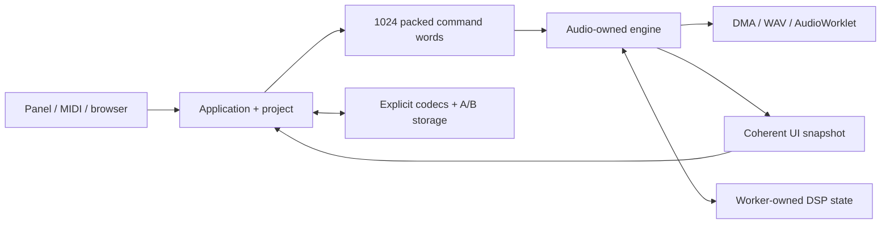
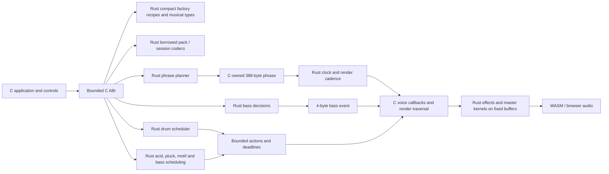

# NAIWAN 91 Rust migration

Execution is tracked in [epic #1](https://github.com/superposition/91/issues/1). Its 25 tickets cover the complete owned firmware, simulator, browser, tools and media code. The last ticket is [How I did it](https://github.com/superposition/91/issues/26), the evidence-based Friday talk.

## Current architecture and qualification — 12 November

Published source `0620997` includes Rust synthesis/voices, FM6, effects/master,
factory recipes, planning/harmonic policy, scheduling, commands, worker handoffs,
codecs and persistence policy. Native scenario parsing, virtual platform/clock
and output sinks run in Rust. Native and browser share the same bounded host
model; the browser platform/clock use six application callbacks. C application
ABI thunks and an operating-system clock observation remain.

Graphics, Runner, UI defaults, frame/cadence policy, encoder acceleration and
storage retries are integrated. Controller helpers, page composition and
visualizers still contain C. Browser/editor/library logic, startup/USB/update
loader, build/media tools and whole-release qualification remain ticketed.
The newer held-input, asset and packaging batch is under combined qualification.

Concrete data boundaries for the talk:

- The command ring retains 1,024 packed words. Producer publication and consumer
  slot reuse require distinct ordering; volatile access alone supplies neither.
- The browser has one 240×240 RGB565 framebuffer and one 31×3,840-byte object
  bank. Persistent foreign pointers come from separate allocation roots.
  Metadata borrows end before callbacks reenter the platform. Store reads
  initialize raw foreign output without borrowing uninitialized destination bytes.
- The target UI carrier is 1,320 bytes, alignment 4. All 193 offsets/sizes match
  vendor C. This measured ABI result is separate from native/WASM layout,
  whole-image linking and physical timing.

[Host/platform proof](rust/combined-browser-platform-checkpoint-20261112.json)
records 170 Windows tests, all 97 native scenarios, repeats/damaged stores and
full-instrument WASM/bindings.
[Callback proof](rust/browser-bindings-allocation-proof.json) covers 15 render
sizes, no owned array/view/BigInt construction or IPC during rendering, and
fixed 32 MiB memory. Frame/store serialization runs in polled MessagePort tasks.
Browser-native allocation and actual device scheduling remain separate checks.

The [USB/UI/rescue review](https://github.com/superposition/91/blob/0e42b1d/docs/rust/combined-usb-ui-rescue-checkpoint-20261112.json)
adds descriptor/EP0, receive collectors, exact-IRQ MIDI queues, button policy,
checked UI classification and rescue/debugger tools. Its 182 Windows tests,
frozen/native/WASM fixtures, seven-crate vendor LTO and natural32 comparisons
with active C assertions pass. It is not a linked/physically qualified release.

The device is restored to known-working 0.3.3: all 30 saved objects are preserved,
and follow-up audio added no XRUN/late/crash counters. The experimental failure
remains unresolved; [restoration record](rust/firmware-restoration-20261112.json).
The LAN preview still serves its earlier qualified artifact. The sections below
retain historical measurements and call maps; their remaining-work statements
describe those earlier checkpoints.

## Earlier combined checkpoint — d1a2204

The maintained Rust implementation now includes the scheduler, phrase planner,
named synthesis families and DJ voices, FM6, effects/master processing, bounded
worker handoff, factory recipes and shared storage/wire/browser/package codecs.
Project transaction policy, remaining legacy harmony, native simulator policy,
the application/UI, platform drivers and other tools remain tracked work. The
following sections retain the earlier checkpoint measurements; they should not
be read as a claim that the whole repository has migrated.

The combined source at `d1a2204` passes **110 Windows workspace tests**, **16**
runtime tests through the opaque MCU atomic ABI, formatting, strict Clippy,
no_std/WASM and release 32-bit MCU-feature checks. Nine complete browser audio
scenarios compare **49,710,788 Float32 values**, with **1,048,576** more values
through the HTTP audio fallback. Four direct comparisons against the immutable
R01 WASM cover **8,948,772 values**. Native frozen-C/current-C0/Rust checks cover
effects completion, worker faults/quarantine, DJ DSP, parameter application and
the real SDK package writer. A subsequent test-only checkpoint `a87ffc9`
requires observed DJ and Rust-worker execution together in all **48** worker
configurations. No production audio source changed in that follow-up.

The browser module is **2,364,109 bytes**, SHA-256
`975b9aff3df287d7b2f34d08056893745f76c407f8432c4a1a19344754f6eef6`.
It retains 24 public exports and fixed 32 MiB memory. These are software
results; interactive browser/device behavior and physical timing are separate
checks. [Combined results, source revisions and artifact/log hashes](rust/combined-checkpoint-20261112.json)
record the scope. The [integrated MCU test](rust/PI32V2.md#integrated-hardware-test-in-progress)
passes static/package gates but has an unresolved USB failure after restart;
it has no audio/deadline qualification and is being restored to the working
probe image.

## Compatibility and ownership

The native/browser builds select the integrated Rust components described above, with explicit C0 comparison paths. Application/controller helpers and hardware lifecycle work remain visible at their boundaries; software comparison does not qualify an MCU image. The current working-tree Songbook/DX7 changes are part of the baseline. Do not reset them to the Git HEAD baseline.

The device uses 256-frame render calls and 512-frame DMA halves at 44.1 kHz, allowing approximately 11,609 microseconds per half. Ordinary RAM is limited to 98,304 bytes, and the 344,064-byte pool must retain 4,096 bytes of reserve.

The design assigns one owner to each mutable subsystem. The command ring has separate producer/consumer endpoints and the Songbook UI consumes a copied view. Application edits, snapshots and worker exclusion are distinct boundaries:



Musical/format/type libraries use `no_std`, forbid unsafe code, and have no dependencies on an allocator or browser APIs. The separate `fm1-rt` queue owns a reviewed `UnsafeCell`/atomic publication boundary. Native tools use `std`. Hardware and foreign-function boundaries have separate safety invariants; `volatile` does not establish thread synchronization.

The agreed upstream exception is the recovery stub: version **3**, SHA-256 `baee55ed142fe1cc336099902fa544d8844ba72182abf669f15cc78fc6bee87c`. Preserve its source and bytes, vendor assets, unavoidable assembly, and thin/generated browser bindings. Generated C may be an intermediate produced from maintained Rust source.

## Baseline — R01

The snapshot was captured before migration edits:

- Original Git HEAD: `5b78ae77897d8bc08981c0a620ab2cce192a2d20`.
- Complete source archive: **440 files**, including modified and untracked work.
- Archive SHA-256: `3d20587f825b8a26cd1f9ab6a715e65e78838fce0c19b5c27ce0427c15fa6263`.
- Local archive, manifest, patch and isolated build: `C:\Users\ericm\fm1\rust-migration\baseline-2026-11-11`.
- Owned executable-source inventory: **204 paths**, assigned to tickets in [rust/inventory.json](rust/inventory.json).

A fresh isolated build reproduced the 0.3.0 firmware package exactly: **611,251 bytes**, SHA-256 `c4f6c00b4a5558101333893f7702d5ce7dd98c297b3391a3f847e7a1b962f61e`. The firmware uses **97,196 bytes** of ordinary RAM and **339,404 bytes** of pool memory.

The complete baseline suite recorded **100 passing checks and 22 failing checks**: three musical-distribution checks (`amb`, `harmony`, `twins`) and nineteen UI scenarios. These are existing outcomes of the untouched snapshot. The fresh WASM smoke check passed with peak **0.231** and **239 blits**. [rust/baseline.json](rust/baseline.json) records exact check names, failure assertions, log hashes, build hashes and resource limits. A known failure is an explicit outcome to compare, not permission to ignore a whole test category.

Existing physical-device evidence remains in `build/hardware/songbook-final`; it qualifies the earlier C instrument, not the new Rust code. Its ten-minute recording, telemetry and restart/readback evidence are indexed in the external snapshot.

## First Rust slice

At this first slice, the workspace contained:

| Package | Responsibility implemented so far |
| --- | --- |
| `fm1-types` | Stable parameter IDs and metadata, Songbook settings, step/scale masks, packed modifiers and command words |
| `fm1-formats` | CRC-32, validated borrowed Jam Pack v1/v2 views, sound-parameter validation and the 20-byte session codec |
| `fm1-engine` | v1/v2 phrase planning, deterministic random state, bass events, sample-clock cadence and bounded drum/phrase scheduling decisions |
| `fm1-rt` | Fixed SPSC command ring, bounded copied snapshots and staging lease arbitration |
| `fm1-cli` | Layout reporting, parameter export, pack inspection/validation and phrase-plan inspection |
| `fm1-jam-bridge` | Audited transitional C ABI used by the browser instrument; diagnostics count execution, rejection and C fallback |
| `fm1-probe` | Compiler/ABI probes for the experimental hardware route; this package is not production firmware |

The synthesis engine, full application, hardware layer, remaining browser logic and other formats/tools are still tracked work. The hybrid browser instrument demonstrates an integrated Rust slice, not a complete Rust instrument or physical-device support.

| Representation | Size |
| --- | ---: |
| Six patterns × six lane masks | 72 bytes |
| 1,024 packed command words | 4,096 bytes |
| Command ring including two indices | 4,104 bytes |
| One beat: four notes, node and flags | 6 bytes |
| One phrase: four header bytes + 64 beats | 388 bytes |
| Two phrase buffers | 776 bytes |
| Jam settings | 10 bytes |
| Stored Songbook session | 20 bytes |
| Sample-clock state replacing four C scalars | 16 bytes |
| Songbook display view / gated cell | 220 / 224 bytes |
| Staging lease state, excluding the retained C buffer | 4 bytes |
| Per-lane scheduling request / bounded three-action result | 136 / 80 bytes |

The planner preserves candidate scoring/tie order, random-number consumption, cadence decisions and delayed following-section behavior. Fixed arrays and borrowed pack bytes keep allocation and expanded graph storage out of the musical core. Rust's native struct layout is never used as a stored or wire format.

### Reproduce

```sh
cargo test --workspace
cargo clippy --workspace --all-targets -- -D warnings
cargo check -p fm1-types -p fm1-formats -p fm1-engine -p fm1-rt --target wasm32-unknown-unknown
cargo run -p fm1-cli -- layouts
cargo run -p fm1-cli -- validate packs/velvet-changes.jmp
cargo run -p fm1-cli -- plan packs/velvet-changes.jmp 6 1 8
# Requires Node 22, Python/Pillow and a wasm32-capable clang/wasm-ld:
sh tests/rust_emulator_parity.sh
# Requires the exact extracted R01 snapshot; verifies all 440 source hashes:
sh tests/reference/generate.sh /path/to/baseline-2026-11-11/source
```

The integration corpus was generated by the retained [C oracle adapters](../tests/reference), compiled against the frozen C snapshot rather than the Rust implementation. It covers four packs, twelve keys, two modes, both section lengths, four forms, four movement settings and eight sequential sections. The checks compare per-case reference hashes over phrase bytes, bass events and random state: **24,576 section outputs**, **27,648 planning calls**, and **4,718,592 bass events**. A separate **44,807-case** corpus compares validation over all bounded lengths and three mutations per source byte. Random-input and invalid-settings probes exercise failure paths.

Session compatibility checks cover **5,120 byte mutations**, all **65,536 tempo words**, and lengths zero through 22. Every accepted mutation re-encodes identically, including unknown trailer bytes. Encoding validates before writing, so rejected records leave the caller's buffer unchanged. A new save reproduces the legacy source marker and zero reserved tail.

## Earlier emulator integration map



`EN_RUST_JAM=1` is the browser default and also enables `EN_RUST_COMMANDS=1`, `EN_RUST_TRANSPORT=1`, `EN_RUST_HANDOFF=1`, `EN_RUST_SCHEDULER=1`, `EN_RUST_MELODIC=1`, `EN_RUST_EFFECTS=1` and `EN_RUST_FACTORY=1`. The factory flag can be disabled independently for linked-footprint comparison. `EN_RUST_JAM=0` builds the C reference. The normal hardware build does not enable these bridges. No caller reference or pointer survives a Rust call. A previous/output phrase may alias; the bridge first copies its initialized header and active beats, avoiding uninitialized C tails. The bridge uses stack copies, so its device stack cost still requires hardware qualification.

The current Rust unsafe inventory is confined to three packages. `fm1-jam-bridge` checks nullable/bounded public payload inputs and supports the documented phrase alias. Its unsafe DSP adapters separately require initialized, aligned, live and disjoint state/config/output regions, exclusive mutation for the call, and no concurrent access to borrowed delay storage. They cannot establish those foreign-call contracts by checking a pointer value. The reverb tank borrow excludes the predelay region used by the other worker. Immutable factory strings and C-shaped pointer tables have narrowly documented `Sync` implementations; loaded voice labels stay in C storage. Its command calls require one serialized producer, one render consumer and exclusive boot-time reset. Its relaxed counters are telemetry, not synchronization. `fm1-rt` uses acquire/release publication and slot reuse; safe Rust obtains non-clonable producer/consumer handles from one exclusive `split`. `fm1-probe` owns the experimental callback, `UnsafeCell`, section-placement and volatile-MMIO boundaries; its mutable cell requires exclusive boot-time access before audio/interrupt use. The musical/format/type libraries forbid unsafe code. Hardware and multicore ownership still need their own reviewed boundaries as those tickets are implemented.

### Command ownership — R08

The ring stores exactly 1,024 `CommandWord(u32)` values and two wrapping `u32` indices: the same **4,104-byte** queue footprint as C. A temporary typed decode exposes one of 39 stable actions, the argument byte and signed 16-bit value; the queue never stores a larger command enum. The producer writes a free slot before release-publishing its index. The consumer acquire-loads that index, copies the word, then release-publishes reuse. The producer's acquire-load of the read index prevents overwriting a live slot. Slot access uses raw pointers without creating an exclusive reference to the whole shared array.

Full queues reject the newest word without changing any queued word. Unsigned wrapping distance preserves full/empty behavior across `u32::MAX`, and the power-of-two capacity preserves physical slot order through that wrap. The frozen C corpus covers four starting positions, preset-like bursts, accepted/rejected publications and ordered drains: each case accepts and consumes 69,520 words and deliberately drops 25,856. An independent `VecDeque` model checks the same boundary cases. A real two-thread test transfers 500,000 patterned words without tearing, loss or reordering. All 39 command kinds preserve every signed payload, including a valid all-zero command word.

In three full instrument scenarios the Rust queue accepts/consumes 961, 751 and 319 commands, drops none, and peaks at 213, 213 and 208 slots. The C command dispatcher and render-block drain points stay in place, so audio/framebuffer/lifecycle comparisons still match the frozen baseline. Telemetry reports accepted/consumed/dropped/high-water counts. The browser executes input/application/render on one worker (or the HTTP fallback's main thread); a physical backend must first supply/qualify 32-bit atomics or an appropriate interrupt-exclusion implementation. Broader application snapshots and physical staging/exclusion qualification remain open parts of R08.

The [Songbook handoff checkpoint](rust/songbook-handoff.md) adds one 220-byte view per UI frame and lease arbitration over the existing 3,840-byte staging buffer. Its destination gate protects the Rust copy; the serialized emulator caller must still exclude changes to the C source. The lease preserves receive, activation and readback lifetimes without allocating a second payload. These unsafe ABI contracts are separate from the safe portable APIs.

The [clock checkpoint](rust/TRANSPORT.md) replaces four C scalars with a 16-byte Rust state for 24-PPQN subdivision, sample phase, external-clock expiry, chunk limits and control cadence. C dispatch remains between scoped Rust calls in its original order, including tempo changes during a musical tick. At that checkpoint, swing, lane/ratchet/polymeter decisions and synthesis still ran in C. Focused proof files record each checkpoint's independent frozen-reference comparisons.

The subsequent [drum scheduler checkpoint](rust/SEQUENCER.md) moves swing/humanization, density/conditions/time/slices/polymeter, fills/ghosts/ratchets, drift mutations, deadlines and Songbook boundary decisions into Rust. Each lane passes a 136-byte request and receives at most three actions in an 80-byte result. The common xorshift RNG word is passed through each call, preserving draw order around the C callbacks; the planner keeps its separate LCG. That checkpoint's twenty-seven frozen-C native scenarios match all timing/MIDI/PCM/RNG/mask/pending fields. Four WASM scenarios compare 37,288,700 Float32 values, including an F4 legacy piece/genre run also checked against the original R01 WASM.

The [melodic checkpoint](rust/MELODIC.md) adds acid mutation/answers, pluck recording and motif playback, bass-line selection, lane sources, bar/queued-FX decisions, eight MIDI gates and sample-based harmonic expiry. Its fixed state packets are 64 bytes for acid, 200 for pluck and 44 for bass; the harmonic view is 92 bytes. A later [scheduling-data checkpoint](rust/SCHEDULING_TABLES.md) supplies the live bass/comp recipes and190 bytes of immutable section/fill data from Rust. Forty-three independent frozen-C traces compare 161,688,822 int32 PCM values and 209,246 MIDI messages plus complete timing/state/RNG records. The audit requires observed motif recording, playback, inversion, alternate/restated phrases and all eight gates; matching a run that never enters those states is insufficient. C retains callback execution, pending-slot storage/application and byte emission. Harmonic construction and voice cleanup remain with their respective ports.

The [factory checkpoint](RUST_FACTORY_TABLES.md) keeps 190 pieces procedural: 176 defaults, compact donor/override recipes, patterns/modifiers, names, mode pools and packed progression arcs. Numeric source tables total 6,542 bytes. A generated preset is a 354-byte temporary value, not a 190-preset runtime cache. Checked 18-byte acid, 12-byte pluck, 6-byte progression and 3-byte chord-kind values preserve the packed layouts. Frozen-C export and boundary corpora cover all 190 pieces, every compact table, cross-byte fields and repeated initialization with loaded/user voice names. Mutable overhead is four 32-bit telemetry counters. The isolated linked WASM grows by 7,970 bytes; that is not a physical-flash measurement.

The [effects checkpoint](rust/EFFECTS.md) supplies tape/Echoplex, reverb/chorus, master filters and performance resampling/control, compressor, limiter and final audio/fixed-USB conversion. Its 233,004 bytes of delay payload stay in the existing C allocation and are borrowed for bounded calls. The 64-slot limiter crosses the seam with 72 bytes of scalar state. Twenty-three native frozen-C/current-C0/Rust cases compare 12,246,104 frames, complete state, ring contents and shared RNG; 24 serial/deferred/pthread/busy-worker configurations match. The independent frozen-WASM FX-panel case compares 2,769,480 values with fingerprint `fd659ab9`. C still performs the outer voice/send/mix arithmetic and shared-ring/predelay/job traversal listed in that checkpoint. Packets copied for every sample remain a transitional cost to remove during later integration; host parity does not qualify PI32 stack or cycle cost.

The [combined engine proof](rust/integrated-engine-proof.json) runs all eight flags together: 49 Windows workspace tests, six fresh-C0/Rust WASM scenarios comparing 41,028,380 Float32 values, three direct frozen-R01 WASM cases comparing 6,297,480 values, and the 43 complete native scheduling traces. Its 25 native FX cases include the two additional external-clock variants and direct impulse/null tests, totaling 13,374,406 frames; 24 worker configurations and protocol response hash `eff97ff8` also match. The pinned no_std/WASM build, browser bindings, metadata/protocol tests and full-site build checks pass. The file records source revisions, artifact/log hashes and scope; subsequent mixer/voice/format work has separate checkpoints.

`tests/rust_emulator_parity.sh` builds both variants from one checkout. At the original three-case checkpoint, two 159.64-second playback runs compare **28,160,000 stereo Float32 values bit-for-bit**, sampled full framebuffers and LEDs, and frozen R01 PCM fingerprints. A third 74.5-second scenario restores a saved v2 pack, holds a phrase for 60 seconds without additional planning, requests New Idea, stops, saves and boots a fresh instance from the saved bytes. Its irregular render requests span **1 to 1,024 frames**, adding **6,570,900 matching audio values**.

All three scenarios pass with **zero Rust rejections, zero C fallbacks and no WASM memory growth**. The preallocated WASM memory is 32 MiB; that is an emulator allocation, not a claim about physical RAM use. The module exposes exactly the 24 browser API/memory exports, with no public Rust implementation symbols. [rust/emulator-proof.json](rust/emulator-proof.json) records the results and artifact hashes.

The GitHub workflow runs native checks on Windows/Linux and builds/tests both emulator variants with pinned Rust 1.94.1 and Zig 0.17.1. The HTTP fallback shares the same processor through a main-thread Web Audio callback when AudioWorklet is unavailable on an insecure LAN origin; its PCM matches 128-frame processing for 1,048,576 values. The user confirmed the LAN emulator works at `http://10.0.0.157:8001/emu/`. Actual Chromium HTTP signal sampling and desktop Chrome startup/panel review are recorded in the [web review](https://github.com/superposition/91/pull/36). Native Windows computer use works from VS Code after focusing the known page; the separate browser connector lacks its access host in this session. Physical phone touch, explicit real AudioWorklet scheduling, optional USB-MIDI and cross-browser qualification remain open.

## Hardware compiler gate — R02

The installed Rust compilers do not expose a PI32v2 target. The experimental route is maintained Rust → mrustc-generated C → vendor clang 4.0.1 → existing linker/package checks. The mrustc source is pinned to `5205980b25d4d15494abdb45103e59e8dc309970`, with Rust 1.90 core sources for the initial investigation. Standard `rustc` remains authoritative for borrow/type checking.

The vendor's LLVM data layout is `e-m:e-p:32:32-i1:32-i64:32:32-f64:32:32-n8:16:32-a:0:32`. The experimental target description must follow measured C ABI behavior; an ARM or RISC-V target specification is not evidence that PI32v2 code is supported.

Generated core C exposes an old vendor-compiler failure in unreachable decimal/parser routines. Final-image LTO removes these unused routines before instruction selection; a relocatable LTO link did not work. A conservative [mrustc patch](../rust/toolchain/mrustc-readonly-statics.patch) keeps provably immutable Rust-owned statics out of scarce `.data`, while excluding interior-mutable and foreign statics. The probe tests retain a writable interior-mutable static to guard that distinction.

The physical compiler gate passed on 12 November 2026. The C instrument plus current Rust probe installed as `FM-1_7000302`: **510,144-byte image**, **97,264 bytes ordinary RAM**, **339,420 bytes pool**, unchanged version-3 recovery stub and no soft-double routines. The device returned the expected planner hash in **652 µs**, exact f32/callback results, a writable interior-mutable static, the explicit pool address and an ordered volatile timer read. All 30 stored objects matched their pre-flash backups. A 60.05-second USB-audio capture had no XRUN, late-render or crash deltas and no shedding. [Physical measurements, ABI and runtime-helper inspection](rust/PI32V2.md) include the explicit abort-only compatibility stub and artifact hashes.

This closes the representative compiler feasibility gate. The full Rust engine still requires its own MCU atomics, link, RAM/pool, stack, multicore lifetime, timing and output qualification. The probe runs once before interrupts/audio begin, so its successful boot and measured cost do not establish those later properties.

## Evidence for the Friday talk

Keep one concrete example per architectural decision: a packed pattern, command word, weighted harmony choice, phrase plan, voice allocation, worker handoff and interrupted save. Attach baseline and Rust outputs, byte counts and timings to the relevant ticket. Explain failures and corrections using their retained evidence.

The current talk walkthrough can use these implemented examples:

1. **Keep the compact representation.** Six patterns of six `u16` lane masks occupy 72 bytes. Hits at steps 0, 4, 8 and 12 are `0x1111`. `StepMod::new(3, 2, 1)` stores ratchet/push/level in `0x53`. `CommandWord::set(ParamId::TUNE, -12)` remains `0x0049fff4`: one command byte, one parameter byte and one signed 16-bit payload.
2. **Validate bytes at an ownership boundary.** A Jam Pack remains borrowed bytes with checked offsets and references; it is not expanded into a heap graph. Stored fields are decoded explicitly. A 20-byte `JSM` session is four header bytes, ten control bytes, a little-endian tempo and four preserved extension bytes.
3. **Preserve musical tie order.** Each beat searches four inversions and at most three octaves. At 16 bars, that bounds candidate scoring to 768 candidates, each with four voices. v1 scores voice movement plus register and inversion penalties; v2 weights voice movement by three and adds a top-note target. Updating only on a strictly smaller cost preserves the first candidate on ties.
4. **Make randomness observable.** The wrapping LCG is `state * 1664525 + 1013904223`. Candidate order and the number of draws are behavior. `fm1-rs plan packs/velvet-changes.jmp 6 1 8` begins with notes `[51,54,57,61]`, node 16 and bass events `[42,100,58]`, `[-1,0,58]`, `[-1,0,58]`, `[49,72,58]`. Its two planned sections leave the seed at 4 for these variation settings.
5. **Integrate one seam and demand evidence.** Play the Songbook in the browser, then show developer telemetry and the retained playback reports separately. The public interface explains music and controls. Explain why fixed arrays, explicit initialization and copying a small phrase made aliasing reviewable. Use the call maps to show the remaining C implementation and the later ports.
6. **Keep large data in place.** Contrast a procedural354-byte preset result with a 190-preset cache, and a72-byte limiter state with the 233,004-byte retained delay payload. Show why the reverb borrow excludes shared predelay, and why moving arithmetic does not by itself prove a physical deadline.

The live demonstration starts with `cargo run -p fm1-cli -- layouts`, validates a pack, inspects its phrase, then runs `sh tests/rust_emulator_parity.sh` and opens the local emulator. Keep the JSON reports available offline. A completed recording and rehearsed slide deck are still required by R25; this walkthrough does not close that ticket.

The final talk ticket requires slides, notes, a rehearsed live demo and an offline recording. Its claims must describe what actually runs. The migration epic closes only after full release qualification in R24.
