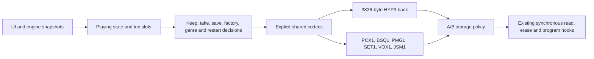

# Project and A/B storage

R06 / [#7](https://github.com/superposition/91/issues/7) now has a maintained,
allocator-free project/persistence implementation in `fm1-engine`. The safe
modules forbid unsafe code through the engine crate. `EN_RUST_STORAGE=1`
selects the real project and NOR consumers; C0 remains selectable. This flag is
independent of the factory and codec adapter flags. The core calls the shared
Rust factory/format libraries directly even when another C adapter is disabled.

## Runtime and saved bytes

`project::Runtime` is a 6,194-byte, C-compatible runtime view: the playing state
plus ten 578-byte slots. These are the existing caller-owned buffers, not new
state copies. The bridge checks the size and slot offset in both languages.
Runtime structs are never serialized. Their 376-byte piece records, HYP3 bank,
PMGL globals, PCX1 extras, BSQ1 steps, SET1 performance settings, VOX1 voices and
JSM1 session use the qualified explicit codecs.



Rust now chooses saved/default/legacy data, sticky globals, boot-last/random
selection and exact RNG consumption; converts HYP1/HYP2 and older HYP3 fields;
keeps progression/kinds, per-piece effects and bass dirty masks; selects set-list
positions; migrates shortened settings and old KND1 extras; and orders bank,
extras, bass and global flushes. Session selection/fallback, save gating,
performance flag packing and autosave priorities/deadlines are also portable.

The C boundary collects frozen lines and volatile engine patterns, applies
returned engine/UI commands, and performs platform I/O. No Rust borrow into the
volatile pattern/modifier arrays is retained: a 168-byte stack snapshot crosses
that seam. All project fields, the image, global and extension arrays are
exclusive for a call. Object callbacks finish synchronously, retain no pointer,
and cannot re-enter or access the borrowed project state.

A recipe lookup used to have an additional engine effect: genre zero set
`naiwan_pending`. A native audio trace caught its omission when the lookup became
pure Rust. The project now returns the last recipe notification, including an
invalid-record recipe reset or factory reset; C calls `en_piece_recipe_loaded`
after the borrow ends. That setter preserves the original invalid-index clamps.
Harmonic policy remains in its own engine module, with this explicit application
seam. Normal-table output equality alone would not have caught the missed effect.

## A/B commit

Each object retains its original pair of 4,096-byte sectors. The existing
3,840-byte scratch buffer is reused. The 32-byte little-endian header is a commit
record, never a Rust struct image. Both headers are read before any payload.
A wins equal sequences; sequences compare numerically, including the original
`0xffffffff + 1 -> 0` behavior. Slot/reserved header fields remain ignored on
load. A corrupt newer body falls back to the older copy.

For a 600-byte replacement with B at sequence 2:

| Last completed operation on A | Restart chooses |
| --- | --- |
| Erase | B, sequence 2 |
| Payload page 1 / 2 / 3 | B, sequence 2 |
| Final 32-byte header | A, sequence 3 |
| Header/body readback | A, sequence 3 |

The driver can return a failure after completing a physical operation: a fully
written header may already be loadable even if program returned an error, and a
failed readback returns `-7` even when restart can load the new copy. Exact
positive/negative hook results are preserved. Zero-byte objects accept a null
zero-length source/destination just as C0 does.

Compatibility includes less obvious existing policies: a bass dirty mask clears
before its write attempt; a failed genre flush does not cancel the genre switch;
and some invalid legacy HYP2 slots retain their partially decoded RAM values
while losing their saved bit. These behaviors are tested, not silently repaired.
Restore locks before attempting the write and stays locked after failure;
unavailable/locked normal writes retain `-9`/`-8`.

## Evidence and reproduction

All 440 immutable R01 source hashes are checked before frozen export. The same
independent C fixture is compiled unchanged against frozen R01, current C0 and
the actual Rust adapters, then executed natively and in real WASM. Routine CI
also checks fixed SHA-256 goldens so simultaneous C/Rust drift cannot pass.

| Corpus | Cases | Bytes | SHA-256 |
| --- | ---: | ---: | --- |
| A/B traces and NOR bytes | 47,709 plus null/zero boundaries | 2,671,736 | `8d398663bfee5443f576cd2da7a8489a0eae639324a4561f40f6e74c07f9226e` |
| Runtime/project state | 3,199 | 204,744 | `5600647c3aa19f68ab38eca6378dd640113a1676bb73e220e359395b18e264b4` |
| Settings, voices, session, autosave | 10,624 | 1,444,872 | `8bf2f2416d5515bbe80a5fec9ef27dd47f6908e22a35b16db17886b315f93804` |

A/B tests cover all 31 objects, zero/max/page-boundary sizes, tie/wrap/corrupt
selection, read faults, erase/program cuts and partial prefixes. They compare I/O
order, return values, guarded loads and both resulting sectors. Additional safe
core tests include 32,768 malformed headers, bounded session/settings mutation,
set-list boundaries, restore gates and wrapping autosave clocks.

The project corpus exercises every genre/piece save/factory/switch, boot-last and
random startup, all KND1 prefixes, shortened PCX1/BSQ1 objects, legacy/default
fallbacks, 12/32-byte globals and failed-flush behavior. The UI corpus exercises
old/current/malformed SET1, all voice counts, selected/missing Jam packs,
reserved session bytes and 8,192 autosave input combinations.

Sixteen native persistence scenarios have equal C0/Rust traces and exits. Fourteen
are assertion-clean; `store` and `genrestore` each retain three known stale
factory-pad expectations in both variants. The exact exceptions are frozen in
`tests/reference/project-scenario-baseline.json`, and new failures are rejected.
Measured CPU text is fixed to zero only in these screenshot tests; nine PNGs are
byte-identical. Runtime CPU reporting remains unchanged in normal builds.

The complete instrument suite compares exact PCM, framebuffer and saved bytes,
including factory/saved/v2-session restart, legacy transitions, stored frozen
lines, FM6 algorithms and effects tails. Extra session-off legacy cases compare
recipe/corrupt-record/factory-reset playback against the immutable R01 WASM too.
The instrument keeps 24 exports and fixed 32 MiB memory; HTTP fallback playback
is still tested. See [the completion proof](rust/project-storage-proof.json)
for current artifact hashes, counts and footprint.

```sh
export RUSTUP_TOOLCHAIN=1.94.1
cargo test --release --locked -p fm1-engine --test persistence --test persistence_ui
cargo clippy --locked -p fm1-engine -p fm1-jam-bridge --all-targets -- -D warnings
sh tests/rust_persistence.sh /path/to/immutable-r01/source
sh tests/rust_project.sh /path/to/immutable-r01/source
sh tests/rust_persistence_ui.sh /path/to/immutable-r01/source
sh tests/rust_project_scenarios.sh
sh tests/rust_emulator_parity.sh
node tests/host/emu_project_test.mjs build/emu-parity/reference.wasm build/emu-parity/rust.wasm /path/to/immutable-r01/source/build/emu/amb.wasm
```

The immutable-source argument is optional for routine CI. Stats 64/65 count A/B
loads/saves, 66 project/UI policy calls, 67 object save attempts, 68 missing A/B
copies, 69 NOR program calls, 70 failed verification and 71 instrumented bytes
across layers. These are witnesses, not synchronization or a unique-flash-byte
metric. Eight counters add 32 static bytes; there are no new state/scratch
buffers. The 52-byte constant callback descriptor is expected in ROM on a
32-bit target; the final MCU map and stack accounting must verify that.

Software persistence acceptance is implemented. Actual MCU emission, full-image
RAM/stack/link qualification and physical power-cut runs are not claimed here.
NOR/IRQ/startup/calibration primitives remain platform work under #19, and the
rest of the UI controller belongs to #15. No live site/server update or physical device access was performed during this checkpoint.