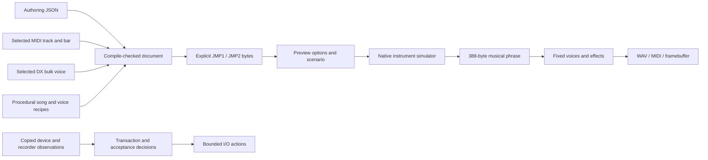

# Musical authoring tools — R20 / issue 21

`fm1-authoring` maintains the pack compiler, canonical decoder, procedural factory
and three songs, selected MIDI/DX imports, previews, host Jam transactions and
full-song acceptance policy in safe Rust. It is a `std` host package with
`#![forbid(unsafe_code)]`; it introduces no firmware image or DSP runtime state.
The existing Python APIs and flags call it through a serialized native binding.
[authoring-proof.json](authoring-proof.json) records the qualified sources,
artifacts and exact evidence boundaries.

## Data and execution



`Document` wraps the compile-checked JSON tree. The tree preserves authoring
metadata and avoids coercing booleans/floats into integer fields. Its insertion
order is retained where opaque metadata contributes to exact pack bytes.
The ordered-map feature is selected by this host package; the independent
browser-codec WASM feature graph excludes those map dependencies. Explicit byte
offsets come from `fm1-formats::jam`; packed output remains at most 3,840 bytes.
Normal authored output also passes the instrument's shared strict validator.
The optional `build/params.json` range table retains its original presence-based
behavior. The pre-existing `fm1-rs validate PACK` command provides strict target
validation independently of the legacy authoring profile.

The factory is generated from compact Rust recipes. Its five adapted DX programs
reuse the maintained FM6 table rather than parsing C source or copying a factory
pack. A selected SMF track produces typed note events with absolute ticks;
sixteenth quantization uses ties-to-even rounding. Harmony imports preserve
group insertion order and root/shape tie order. The 16 MiB MIDI parser checks
chunk/event boundaries before access. Inspection retains signed SMPTE and zero
time divisions; bar import returns the original no-selected-notes error for
them. DX file selection retains the permissive
bulk-header profile, including concatenated-bank indexing and legacy checksum
behavior; live protocol validation remains separate.

The host Device is an action machine. Each call returns a copied state and one
request, clock, iterator, sleep or send action. Rust retains no Python iterator,
OS handle, pointer or borrow across a callback. Uploads retain 256-byte chunks,
readback retains 64-byte replies and a 3,840-byte limit, and save verifies the
device acknowledgment, readback CRC and prior active CRC. Error/abort ordering,
first matching reply, timeout boundaries and selection of a single named port
remain unchanged. The Python adapter preserves backend exception objects across
an abort transaction. Device callers remain serialized, as in the existing tool.

Acceptance uses the same approach for activation polling, scheduled profile and
song changes, upload, stop handling, cleanup, telemetry assertions and reports.
Rust writes the PCM16 WAV through the simulator's existing sink. Its float64
reduction tree preserves the former NumPy RMS report. Python supplies monotonic
clock observations and recorder buffers; it does not calculate musical or
transaction decisions.

The Python files retain argument parsing, file/OS timestamp handling, standard
JSON/diff presentation and actual MIDI/audio adapters. `songbook.py` retains the
three-file/header export loop. These are compatibility bindings and I/O, with
the musical generation and header formatting delegated to Rust. No Python
musical implementation is retained as an alternate production path.

## Commands

```sh
cargo +1.94.1 build --release --locked -p fm1-cli
target/release/fm1-rs author factory build/harris.json
target/release/fm1-rs author factory-song build/song.json --song 2
target/release/fm1-rs author compile build/song.json build/song.jmp --c-header build/song.h
target/release/fm1-rs author validate build/song.jmp
target/release/fm1-rs author decode build/song.jmp build/decoded.json
target/release/fm1-rs author inspect-midi reference.mid
target/release/fm1-rs author import-midi reference.mid build/song.json build/edited.json --track 1 --tonic 4 --bar 2 --role bass --minor
target/release/fm1-rs author import-voice bank.syx build/song.json build/voiced.json --voice 3 --role bass
target/release/fm1-rs author preview build/song.jmp build/preview --bars 16 --bpm 127 --key 4 --minor --phrases 4
```

The `author midi-log INPUT OUTPUT --bpm N` subcommand also exposes the exact SMF
sink. Existing `python tools/fm1_jam.py ...` commands and function signatures stay
available, including connected operations. Native authoring errors follow the
existing `fm1-rs` exit status 2; the Python CLI preserves status 1 and its API
exception categories. JSON exports preserve values, structure and object-key
order. Native UTF-8 text may use different Unicode escaping. Malformed text uses Rust parser diagnostics
while retaining the ValueError/error-status workflow.

The binding starts one serialized `author-stream` process and bounds each JSON
message to 128 MiB. `FM1_AUTHORING_CLI` can select an already built native CLI;
otherwise the existing pinned host builder is reused. `author-api` remains a
single-request interface. The Rust CLI and offline pack work need no Python,
mido, NumPy or audio library. Preview uses the maintained native host build; on
Windows it starts a login shell in Ubuntu-22.04 so the installed cargo path is
available. Caller-controlled paths are separate arguments, never shell code.

## Evidence

- Every frozen comparison verifies all **440 R01 source hashes** first.
- **903** authoring cases compare factory/song JSON, exact JMP bytes, defaults,
  Unicode metadata, invalid fields, v1/v2 canonical round trips, binary mutations,
  MIDI type/track/bar selection, quantization ties, harmony and DX bank indexing:
  **600 accepted / 303 rejected**. Historical numeric-version, ordered/nested
  opaque-metadata and omitted-cadence behavior is retained explicitly.
- **167** fake Device cases compare exact callbacks, request bytes, sleeps,
  returned values and errors: **53 accepted / 114 rejected**. They cover chunk
  boundaries through 16,383 bytes, abort failures, malformed replies, timeouts,
  save/readback consistency, port selection and all 22 control fields.
- **15** complete fake-device/recorder acceptance runs compare callback order,
  every JSON report, exit status and WAV bytes. They include successful songs,
  delayed/missing activation, short runs, missing telemetry, xruns/late/shed,
  callback flags, home-key drift, missing songs, stop, control and cleanup faults.
  Twelve additional RMS/peak controls include **16,777,218 PCM samples**.
- **Six full native previews** cover all three songs in major and minor, four
  16-bar phrases, tempos 70/127/190 and transposed keys. **37,712,896 frames**
  match frozen pack, scenario, WAV, MIDI, framebuffer and outgoing-log bytes.
  Peak PCM16 is at most 5,319; no clipped or stuck MIDI notes remain. A complete
  process restart reproduces all artifacts. The frozen host's measured CPU text
  is test-only forced to zero to match the virtual platform; audio is unchanged.
- **11 CLI cases** compare the shipped Python commands with frozen Python and
  native Rust, including C headers, errors and stream recovery. The existing
  **eight Jam tool tests** and **two real C protocol bridge tests** pass.
- The workspace has **136 passing tests**; pinned formatting and strict Clippy
  pass. Windows and Linux release CLIs build. A Windows-native preview executes
  the real WSL simulator successfully.

The factory hashes retain `5af1401d…` (Harris), `5ff54336…` (Velvet),
`19e42007…` (Afterhours) and `6f77429c…` (Neon); complete hashes are in the proof.
For a talk example, Velvet in key 11 major at 70 BPM, four 16-bar phrases, takes
pack `5ff54336…` through the fixed phrase buffer and produces 9,770,496 frames;
its complete WAV hash is
`b48c92a15ab6de4a0f23ab78ec2ad595abf35747570d7fbd48cf9bda34d835a6`.
The host CLI is 839,680 bytes on Windows and 1,112,920 bytes on Linux at this
checkpoint. These host artifacts and simulator timings do not qualify MCU
cycles, memory or physical USB/audio delivery.

## Reproduce and boundaries

On Linux with the frozen source extracted, installed Rust 1.94.1, a C99 compiler,
Pillow, mido and NumPy:

```sh
bash tests/rust_authoring.sh /path/to/baseline-2026-11-11/source
cargo +1.94.1 test --workspace
cargo +1.94.1 fmt --all -- --check
cargo +1.94.1 clippy --workspace --all-targets -- -D warnings
```

The runner contains no workstation paths and opens no device ports. The initial
proof used existing Windows mido 1.3.3 / NumPy 1.24.4 for independent Python
oracles and WSL Linux for the C/native preview comparison. A subsequent complete
Linux run uses Python 3.10 and an isolated ignored build venv with mido 1.3.3,
NumPy 1.24.4, Pillow 12.3.0 and packaging 26.3. No global package or toolchain
changed. CI can install those oracle dependencies and invoke the same runner.
The frozen `build/params.json` is optional,
matching the original tool behavior; no build writes into the baseline tree.

The engine/application ABI used by preview remains the native simulator's
transitional boundary tracked under its own tickets. Physical MIDI delivery,
real recorder callbacks and device timing remain physical qualifications. Their
adapters were not exercised against a device here. No firmware, UI, live build,
server, loader or physical instrument was modified.
