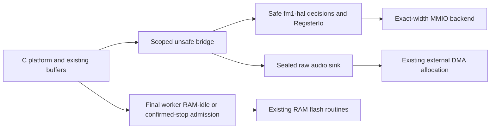

# Startup, register transactions and retained DMA publication

This is a software checkpoint for R17 / issue #18. `EN_RUST_HAL` remains off by
default, and the physical backend is unqualified. No device was accessed for
this work. Ordinary C0 behavior stays selectable; this document does not close
the clocks/input/flash/guard/watchdog or physical acceptance work below.

The dependency-free production `fm1-hal` crate is safe `no_std` and forbids
unsafe code. It contains boot decisions, private-constructor register widths,
exact register-event sequences, raw-publication decisions and flash admission.
It depends on neither engine, app nor runtime. The scoped bridge supplies
volatile MMIO and the existing CPU0/IRQ/worker contracts.

## Real consumers and retained boundaries

| Area | Rust path used by the application | Retained C / ISA work |
| --- | --- | --- |
| Early startup | TIMER4 setup, noinit bootguard entry and readable-range decisions | Entry assembly, section copies/zeroing, mailbox/stack painting, reset capture, core1 start and guards retain their order |
| IRQ/timers | Exact vector/priority writes and TIMER5 setup | Fatal vectors, ISR assembly, bank initialization, hot timer ACK/ticks remain inline in RAM |
| GPIO/ADC/audio/display | Existing GPIO sequences within ADC, ALNK/codec and SPI/LCD setup; bounded ADC polling | General GPIO/input scanning and peripheral lifecycle/publication remain C |
| Audio output | Real output conversion and gap-then-hush fades publish through a raw sink; silence and C-only DSP stores use the same HAL1 sink | Voice traversal, existing buffers, ISR entry/ACK and USB tap remain explicit C plumbing |
| LCD | Exact initialization/baud/command/data sequences; readiness never releases on timeout | C busy/quarantine state and LCD transfer controller; graphics callers need the separately reviewed retained-LCD provider guards |
| Flash | CPU0 admission decisions plus the existing Rust A/B object policy | Supported-chip ID/suspend behavior and all SFC-off SPI/cache routines remain original RAM code; no new Rust/XIP call runs while SFC is off |

Boot entry remains stateless before `.data`/`.bss` setup. The noinit record is
copied to four stack words, processed and published without borrowing noinit
storage. The existing u32 failed-boot wrapping quirk is preserved. Boot now
requires a positive backend fact for ALNK/display/SPI quiescence and CPU1 hold
before zeroing BSS/pool; an unknown fact enters the chip update loader instead.
Boot-health and intentional-reset application transitions remain C; their
corresponding safe decisions are not yet application-qualified.

## Audio lifetime and overrun policy

The DMA allocation is never converted to a Rust reference, including the final
output pass, C-only DSP adapter, integer fades and silence. A sealed sink stores
bounded words through the original allocation root. Diagnostic/test callbacks
are absent in production. The sink cannot call engine/UI code. Float inputs and
the distinct synchronous USB staging output keep their scoped borrows.

Half/generation observations never establish exclusive access: DMA can advance
immediately after any check or store. The model permits at most one raw word
after an observation becomes stale, then requests stop. A failed stop remains
quarantined; neither elapsed time nor an enable-bit readback releases memory.
An observed loss latches stop/quarantine and prevents automatic restart. Zeroing
or explicit reinitialization requires confirmed quiescence. A successful
explicit idle mute may stop, zero and restart under saved IRQ exclusion.

The bridge Cargo feature `hal` enables the retained controller; `hal-test`
implies it and is forbidden with `pi32v2`. HAL0 uses a plain raw sink, with no
DMA controller/global/provider dependency. Volatile supplies no exclusion or
atomicity, and HAL0 makes no new deadline/completion guarantee. A physical HAL1
C build cannot link to a bridge missing its required HAL symbols.

HAL1 adds 24 bytes for the 32-bit private controller, four for its atomic active
flag and four for the CPU0 flash transaction word: 32 source bytes before linker
alignment. No audio/pixel/flash payload was added. Existing 512/1024-word halves,
DSP state, 3,840-byte staging payload, capacities and placements are retained.

## Flash admission and Busy

`plat_store_begin/end` is bounded and nestable. Each admission/update saves and
restores exact ICFG; it performs no join, spin, atomic lock or long masked wait.
An online worker must publish its FINAL `.dsp_text` completion after returning
from XIP. An early Rust job-complete/stage flag is insufficient. Logical offline
or Safe Mode flags prove nothing; only `FM1_FLASH_CORE1_STOPPED()` may positively
supply an alternative physical hold fact. The default fact is unknown/false.

Admission precedes application mutation. New jobs use the existing serial DSP
placement until the balanced end, while IRQs remain enabled between short flash
windows. `EN_RUST_HAL` guards each active read/program/erase/resume entry before
SFC changes, including OTA wrappers. Nested transactions cannot let a new CPU1
job appear between project/session object reads. Timing of that serial interval
requires device qualification.

A positively stopped CPU1 may admit flash-only recovery while its Rust worker
spans remain quarantined. This does not clear/reclaim their generation, publish
joined status, touch those spans or resume CPU1. Unknown stop still denies. DSP
retirement/reinitialization is a separate protocol.

`PLAT_STORE_BUSY` (-10) is distinct from missing/corrupt data. Denied loads never
copy into the destination or mark missing/damaged. A save denied before current
selection cannot erase a valid record. Admission-denied restore does not latch
the restore lock. Project/session transactions deny before defaults/flags/state
change; UI and wire callers must retain the request and retry. The safe project
core's `Objects` contract requires complete admission before its multi-object
methods. See [HAL_STORE.md](HAL_STORE.md) and its independently committed API.

The store bridge also stopped forming a typed reference to a possibly
uninitialized C automatic destination. It verifies into the existing initialized
scratch, then performs one raw copy on success. No extra payload was added.

## Qualification

All commands use Rust 1.94.1 explicitly. Native parity compares the immutable
R01 source (all 440 hashes verified), fresh C0 and the real Rust consumers.
Retained evidence and exact artifact hashes are in [hal-proof.json](hal-proof.json).

- `tests/rust_hal_parity.sh ../baseline-2026-11-11/source`: 320 complete
  width/order/register traces; 33,890 readable-range results; 96 actual startup
  cases for each core mode, plus unknown-quiescence cases; 65,536 nested incoming
  IRQ words; actual LCD timeout/quarantine and last-poll/late-ready tests; 3,608 actual audio ABI advancement
  boundaries with confirmed/unknown stop and stale generations.
- `tests/rust_hal_audio_parity.sh ../baseline-2026-11-11/source`: both half sizes
  and two nonzero full-engine scenarios. Each scenario has 564,151 frames and
  6,000 render calls. Frozen/fresh/full-Rust and C-only-DSP/HAL traces agree;
  each Rust/HAL run performs 2,020,494 guarded word stores, no stop fence.
- `tests/rust_hal_store_admission.sh ../baseline-2026-11-11/source`: 256 direct
  admission-header combinations; 25 A/B denial boundaries; 13 C0/Rust project
  and session denials; real stopped pthread retaining a quarantined generation;
  full frozen PCM/state with 1,765 nested serial intervals per scenario and
  4,598/4,602 backend jobs whose early Rust completion cannot admit flash.
- `tests/rust_persistence.sh` / `tests/rust_project.sh`, with the frozen source:
  47,709 storage and 3,199 project native/WASM cases remain byte exact.
- Existing FX default/extra/controls, FX/FM worker and worker-lifetime matrices
  and the complete emulator parity suite are rerun against the final source.
  Public WASM exports remain 24 and memory remains 32 MiB.
- Strict-provenance Miri checks retained DMA root pointers and initialization of
  an initially uninitialized foreign store-load destination.
- Pinned release workspace tests: 133 pass independently on Windows and WSL;
  9 explicit HAL fake-backend tests and 16 MCU-facade runtime tests also pass.
  Warning-denied Clippy, format and no_std/WASM checks pass. Windows/WSL target
  directories are separate.
- `JIELI_TOOLCHAIN=... bash tests/compile_hal_target.sh`: vendor HAL1 main and
  engine objects compile. This is not an image-link or physical proof.

## Memory map evidence and remaining acceptance

The inspected pre-HAL full target artifact was built with APP/HAL off: 574,704
image bytes, body 570,896 / 573,440, RAM 97,988 / 98,304, pool 339,404 / 344,064.
Its final load address is `0x0208c610` below `0x0208d000`; RAM ends `0x01c1fec4`
below `0x01c20000`; pool ends `0x01c72dcc` below `0x01c74000`. The known-working
0.3.3 and old experimental image also fit their inspected load/section ranges.
This provides no evidence that image size caused a crash, and does not prove
the new HAL image fits or runs. No device/crash causality is claimed.

The existing mrustc/vendor crate build list must include `fm1-hal`; emission
and linking of that new crate through the MCU compiler remain unqualified. The
new bridge `hal` Cargo feature and C `EN_RUST_HAL=1` are explicit opt-ins, separate
from the ordinary/default physical build.

A boot flash admission denial enters the chip update loader before application
defaults or state are touched; it never reclassifies Busy as an absent chip.

HAL1 stays disabled until real boot/ALNK/display/CPU1 stop providers, the mixed
C0/APP retained-LCD guards, UI/backup/Songbook/OTA Busy callers and exact IRQ
capture integrations are combined. Root owns hardware/compiler/atomic/core1
integration. Required open qualification includes the complete image link and
RAM-to-XIP/address/soft-double/overflow gates; stack/pool/flash limits; measured
serial DSP and masked-window deadlines; electrical ADC/GPIO/audio/display/input;
flash suspend/resume and both chips; reset/watchdog/panic/Safe Mode/recovery.

Remaining active C port scope is explicit: clocks/reset/P33/watchdog, IRQ-bank
and fatal/guard setup, general GPIO and matrix/encoder/key scanning, low-level
RAM flash/cache/SPI routines and startup section-copy/lifecycle orchestration.
No whole-ticket closure or physical backend qualification follows from these
hosted results.
