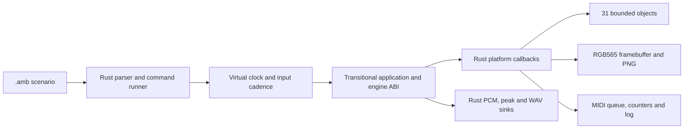

# A deterministic native scenario runner

The normal native build now runs maintained Rust simulator policy. `sh host/build_host.sh` produces the existing `build/host/amb_host` command using `fm1-sim`; `EN_RUST_HOST=0` retains the original C0 runner. The Rust CLI also builds directly with `cargo +1.94.1 build --release -p fm1-sim --features rust-engine`.

This is a qualified checkpoint for [R15 / #16](https://github.com/superposition/91/issues/16), **not ticket closure**. The application, UI, drawing primitives and parts of the engine still compile from production C behind an explicit transitional ABI. Removing that dependency belongs to #15 and subsequent integration. The new runner does not compile `host/amb_host.c` or call its parser, timing loop, assertions, platform implementation or file writers.

## Architecture



`fm1-sim` has a safe Rust library for the clock, bounded parser, comparisons, platform model and sinks. Its default feature set needs no C compiler. The `c-app` feature explicitly builds the transitional C application/engine; `rust-engine` additionally selects the integrated Rust DSP/transport/format/worker paths available at this checkpoint. The CLI is qualified on Ubuntu 22.04 under WSL. The portable components also pass their Windows tests.

The native build uses the installed Rust 1.94.1 toolchain, `cc`, `ar`, Python and Pillow for the existing font generator.

The ABI adapter, `host/rust_sim_app.c`, captures private app observations and layout constants, starts the app, exposes bounded Runner rows and delegates existing app actions. Assertions and scenario decisions live in Rust. Graphics/UI state remains inside the current application until #15 replaces it.

| Representation | Capacity or payload |
| --- | ---: |
| Backing object bytes | 31 × 3,840 = 119,040 bytes |
| Framebuffer | 240 × 240 × 2 = 115,200 bytes |
| Incoming MIDI ring | 256 packets, 1,024 bytes |
| MIDI CC counters | 128 words, 512 bytes |
| Encoder accumulators | Seven signed words |
| Restore and upload scratch | Two address-stable 3,840-byte buffers |
| Render output | 256 stereo signed 32-bit frames, 2,048 bytes |
| Scenario record | At most 511 bytes; four token widths 31/255/63/63 |

These are host allocations. None is added to the MCU image by building the simulator. File sinks buffer blocks rather than issuing a host write for every sample. Stored objects are bounded independently of file size; imports read only the same first 3,840 bytes as the original host.

## Preserved behavior

Time advances in unsigned millisecond steps. Each step services Songbook input, renders due 256-frame blocks using the original binary64 deadline addition, then runs a UI frame every 16 ms or the intervening input-only scan. Reboot resets the same application state without resetting virtual time, held controls, audio/UI deadlines, storage, recording or counters.

Every existing command remains available, including signed encoder detents, exact `spin` acceleration suppression, button/key delays, white/black key aliases, MIDI packing, `waitfor`'s 10 ms polling, seed handling, frames, echoes and assertions. Rust also maintains legacy bank construction, damaged-store generation, restore variants and the video-only Runner autopilot.

Compatibility includes less obvious original behavior: only the first four object lengths start at -1; the other 27 start as present, empty objects. A full MIDI input ring overwrites slots in the original order. Fatal commands return 2 immediately rather than completing the normal final-state/report path. Known assertion failures remain failures with their exact values and messages.

The original host derives displayed CPU load from measured wall-clock time. That changes pixels and redraw hashes between runs. The virtual platform reports CPU telemetry as zero; the test-only original-host adapter stabilizes only this telemetry by returning zero from its clock-cost function. Actual measured host render cost remains in the summary and is the sole normalized log field. PCM, MIDI, assertions, pixels, blits, inputs and stored objects receive no normalization.

## Borrow and callback map

The executable is a single-threaded app instance. No Rust platform or sink borrow crosses a call into C. C callbacks take short thread-local borrows and access only their own platform data; store callbacks synchronously copy their source and never retain pointers, re-enter the app or inspect project state. Invalid object/length and locked-save checks happen before borrowing source bytes. Empty copies do not construct slices from null pointers.

`en_render` writes one separate 512-word block for the duration of its call. LCD blits synchronously copy the C strip into the host framebuffer; they retain no strip/DMA pointer. Runner capture, app observations and layout capture retain no pointer.

Two APIs do retain pointers: `ui_restore_start` waits for a fade/store, and `en_jam_upload` waits for a render boundary. Their source buffers are address-stable boxed `UnsafeCell` allocations owned for the entire simulator instance; scratch access uses scoped raw copies and exposes no persistent Rust reference. The app never reads them concurrently. Restore is detached before the allocation is released, and no app callback runs after simulator shutdown. This boundary does not enable a threaded native worker or change physical ownership/retirement policy.

## Evidence and reproduction

[native-simulator-proof.json](native-simulator-proof.json) records the immutable source, binary identities, complete per-file hashes and known failures. One command builds five independent variants and compares the entire corpus:

```sh
RUSTUP_TOOLCHAIN=1.94.1 PARITY_JOBS=8 sh tests/rust_simulator.sh /absolute/R01/source
```

The variants are original frozen C, fresh current C0, the Rust runner with the frozen C app/engine, the Rust runner with current C0, and the Rust runner with current Rust DSP enabled. The R01 source is checked against all 440 frozen hashes. Results and paired artifacts remain under `build/simulator/runs/`; `results.json` records every compared output.

- All **94 historical scenarios** preserve their exact outcomes: 75 successes and the same 19 failure fingerprints recorded in the original baseline.
- Three additional cases exercise frames, strum, autopilot, legacy banks, object roundtrips, upload, ordinary command/I/O failures and 129 damaged-store/restart trials. The latter retain 27 exact pre-existing out-of-range-parameter observations; they are recorded rather than fixed by this port.
- Across 97 cases, **80,748,288 audio frames / 161,496,576 signed PCM values** compare completely. Every rendered block is captured, including periods outside WAV recording.
- **538 artifacts per variant** compare byte for byte by full SHA-256: 238 PNGs, eight WAVs, 97 raw PCM files, 98 text outputs and 97 binary state/object outputs. Each complete artifact set is 753,826,710 bytes. Final state includes every backing-store byte, length, framebuffer pixel, input/LED/MIDI field, deadline and output peak.
- Fresh Rust processes repeat the complete first song, interaction fixture and damaged-store sweep with identical outputs and normalized logs. The normal native build entry also passes the real piece-sharing save/import/voice/extras/set-list roundtrip.
- Pinned Rust 1.94.1 formatting, **113 workspace tests**, workspace clippy and featured CLI clippy with warnings denied pass. Five portable simulator contract tests also pass on Windows.

The release binaries measured here are 752,384 bytes for current C0, 1,220,000 for the Rust runner with C0 engine and 1,398,056 with current Rust DSP. These are host executable sizes, including standard-library/application/engine code. They do not measure MCU flash, RAM, stack or deadlines.

## Remaining work

Full #16 acceptance still needs the Rust application/UI/graphics boundary from #15, removal of production C from the native runtime and qualification of the resulting combined executable. The private observation adapter inherits the original valid-range requirements for app selectors; this checkpoint preserves the existing bounded scenario corpus and ordinary error behavior. A graphical SDL frontend is not present in the source inventory and is not introduced here. Hardware, live web builds, user workspace and remote tickets were untouched.
