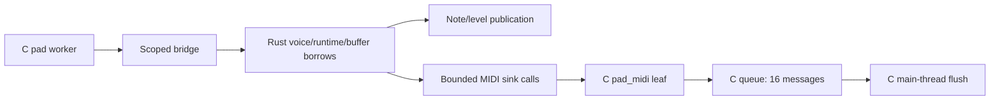

# Pad worker and bus checkpoint

This continues [R10 / #11](https://github.com/superposition/91/issues/11) after the [percussion/pluck](VOICES.md) and [drone/acid](VOICES_TONAL.md) checkpoints. The Rust-enabled emulator now executes the pad's complete sample loop, 32-sample control updates, breathing envelopes, handoff/key-release behavior, pitch/vowel coefficients and intrinsic low-pass bus. Rare application calls to `pad_breathe` share the same Rust implementation. The original C0 functions and default physical build remain selectable.

The [portable pad module](../../rust/fm1-engine/src/voices/pad.rs) uses four existing 148-byte voices, a 24-byte runtime containing the existing gain/stab envelope and four control counters, and the existing read-only sine table. A 164-byte parameter packet is captured once per block; a 28-byte publication reports which note/level fields changed. The bus borrows its four filter values, two inputs, two outputs and the existing 512-frame dry ring. It uses the shared fast-math exponential's original split-ln2 reduction. No allocator, parallel voice bank, per-sample packet or additional diagnostic storage is introduced. Counters 42 and 46 use the previously reserved slots for pad and bus blocks.

## Borrow and callback boundary



| Entry | Rust borrows | Callback effect |
| --- | --- | --- |
| `fm1_rust_voice_pad` | Four voices, runtime, immutable config/table, two output buffers, separate result | `pad_midi` only writes the disjoint C queue |
| `fm1_rust_voice_pad_breathe` | One voice, immutable breath config, a scoped RNG value | Same queue-only callback |
| `fm1_rust_voice_pad_bus` | Four filter values, immutable config/inputs, two outputs and dry ring | None |

The callback must not read or write any borrowed voice, runtime, config, RNG seed, sine table, publication or output region, and must not reenter rendering. The current `pad_midi` leaf only writes the three C queue arrays and count. The bridge retains no pointer or callback. Rust never borrows that queue: main render may flush it before the asynchronous worker joins. Keeping the queue outside the runtime avoids claiming exclusive Rust access to memory that main can consume.

The legacy C producer/consumer synchronization remains work for [#14](https://github.com/superposition/91/issues/14)/[#19](https://github.com/superposition/91/issues/19). Host worker PCM tests do not physically qualify that asynchronous MIDI handoff. Serialized native/WASM MIDI event order still matches R01 exactly.

## State and cadence

The existing `hand` field has steady/fade-out/fade-in states. A completed fade-out starts a new breath on the target note, and fade-in returns to steady. The separate `play` field selects algorithm/held/released envelopes; release reaching zero returns to the algorithm and starts a new breath when enabled. Keeping these fields separate preserves the existing overlap rules.

Voice phase/filter locals, the pre-update amplitude used by controls, the block-local saw flag, target/index defaults and per-voice stab envelope all retain their original lifetime. The shared stab envelope still decays by `ceil(n/32)` per block, and each voice's control counter continues across blocks with unsigned wrap. MIDI off precedes the new on; silence/manual settings preserve the original RNG consumption. Publications retain stale note/amplitude fields for voices skipped by the quiet fast path.

## Evidence

[voices-pad-proof.json](voices-pad-proof.json) records exact artifacts, traces and host cost trials.

- Three hundred twelve independent frozen-C cases cover all 24 pad sounds with ten breathing/stab/manual/handoff/held/released/DX/silent variants each, plus 72 bus settings. Each runs 128 calls with sizes 0, 1, 31, 32, 33, 127, 128, 129 and 256. They compare every pre-bus or bus output, private voice/control/RNG/UI field, queued MIDI byte, low-pass state and dry-ring value. Queue-full, RNG change, silence, DX swell, handoff and key-release execution are explicitly required by the portable test.
- The vectors contain 6,439,056 Float32 PCM values. Every compared waveform difference is zero, every output is finite, and the maximum observed raw magnitude is 2.11818099 under the asserted bound of 64. The independent 961-point exponential corpus also matches the original C routine over its reduction/clamping range.
- Complete C0/Rust/R01 fixture exports and native binary traces match. The existing full 43-case frozen-source suite still matches 161,688,822 integer PCM values and all MIDI/scheduling state. All six current WASM scenarios match 41,028,380 Float32 values, UI and saves; HTTP adds 1,048,576 values. The F4 case matches the original R01 WASM too, observes 6,047 pad and bus blocks, and retains 24 exports/fixed 32 MiB memory.
- C0/Rust/R01 handoff checks retain `eff97ff8`. The 24 serial/deferred/pthread/busy-worker PCM cases also match frozen C. Rust 1.94.1 formatting, 55 workspace tests and clippy with warnings denied pass on this branch.

Release host medians are about 118–192 ns/frame for the measured four-voice pad workers and 5.3 ns/frame for the measured bus calls. Rust/C ratios range from 1.01 to 1.52. The measurements include adapters and existing block work; the proof retains all trials. They establish no physical stack/RAM/atomic or deadline qualification.

```sh
RUSTUP_TOOLCHAIN=1.94.1 sh tests/rust_pad_parity.sh /absolute/R01/source
RUSTUP_TOOLCHAIN=1.94.1 sh tests/rust_melodic_parity.sh /absolute/R01/source
RUSTUP_TOOLCHAIN=1.94.1 sh tests/rust_emulator_parity.sh
RUSTUP_TOOLCHAIN=1.94.1 sh tests/rust_handoff.sh /absolute/R01/source
RUSTUP_TOOLCHAIN=1.94.1 sh tests/rust_effects_workers.sh /absolute/R01/source
```

Voice triggering/cleanup, slower chunk-rate drone envelope/modulator updates, parameter-to-block setup and numeric kit/sound data still have C implementation. These remain explicit follow-up work. The active noise/vinyl and pad chorus use the existing safe effects kernels. FM6/allocator is #12 and outer mixing is #13. No hardware, live server, push or remote issue was changed.
