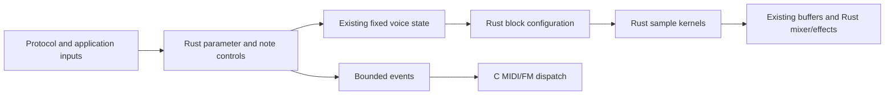

# R10 voice parameters, modulation and lifecycle

This checkpoint completes the local control/numeric boundary for the pad, analog bass, acid, plain pluck and six drum lanes after [block configuration](VOICES_CONFIG.md). The active noise/vinyl sample kernel already comes from the Rust effects implementation. DJ/snippet sample rendering is the next additional [#11](https://github.com/superposition/91/issues/11) scope; this checkpoint does not claim that every sound-producing feature or the complete C engine has migrated.

The work is based on canonical `4e8fd1a1e08e580cb7fc92467f9413abba9b0096`, including the current FM6, codecs and default-off MCU atomic facade. The bridge keeps the explicit `fm1_rt::atomic` imports. This checkpoint performed no hardware I/O, flash, live-server change, push or remote-ticket action.

## Data and calls

The portable [parameters.rs](../../rust/fm1-engine/src/voices/parameters.rs) calculates all 31 voice/lane parameter curves, tuning, plain-pluck slot alternation, note duration and MIDI velocity, manual pluck register/velocity mapping and pending acid decay. [setup.rs](../../rust/fm1-engine/src/voices/setup.rs) also handles partial initialization, breath restarts, LFO reset/routing, links, bass start, acid manual/release and bass-line reset. Existing C dispatch remains at its original MIDI/FM call sites.



The drum attack now captures raw lane decay/tuning plus snare rise, percussion fall and crash request in 32 bytes; Rust applies those decisions before calculating attack coefficients. Pluck conversion mutates the existing 0/1 slot and returns a 20-byte result. A manual pluck result is eight bytes. The two original link floats become one eight-byte `Links` view, with no increase in persistent payload. LFO routing returns eight floats (32 bytes). All existing voice counts, control counters and block configuration sizes remain fixed; there is no allocator, extra voice/table bank or diagnostic allocation.

Reinitialization deliberately keeps the original partial-reset semantics. In particular, it preserves `mod.rate`, pad filter state, increments, subphase, held-key envelope and all other omitted fields. A quiet Start restarts only the same voices as C and suppresses their old MIDI note-off in the same way. Note allocation still precedes UI publication, and all C MIDI/FM callbacks follow publication and the end of the Rust borrows.

| Bank | State bytes | Fixed capacity | Refreshed host release cost, ns/frame |
| --- | ---: | ---: | ---: |
| Pad | 148 per voice, 24 shared runtime | 4 | 123.9–193.5 for the four-voice worker |
| Analog bass | 96, plus 12-byte line state | 1 | 26.6–53.8 in representative measured cases |
| Acid | 108 | 1 | 14.9–42.2 in representative measured cases |
| Plain pluck | 28 per voice, existing 4-byte slot | 2 | 19.8–64.2 in representative measured cases |
| Drums | 104 per lane | 6 | 6.5–73.1 per isolated lane; about 144–147 for all lanes |
| Noise/vinyl | 124 for two generators/held state | 2 generators | Existing effects qualification; not separately timed here |

The cost table describes the release host harness, including output clears, adapters and periodic retriggers. Exact refreshed trials are in the proof. These numbers are not physical target deadlines. The linked older per-family proofs retain their own historical cost measurements.

## Borrow/callback map

Parameter/identity/note conversion, hat setup, link updates, LFO routing and partial init retain no pointer/reference/callback. Their inputs and outputs are aligned, live and disjoint; mutable regions are exclusive for the serialized call. Pluck conversion borrows only the four-byte slot and its separate output. LFO routing only reads parameters/two LFO states and writes its separate result.

The breath-restart call exclusively borrows four pad states and an immutable breath config, with a scoped RNG value. Its sole C callback is the existing `pad_midi` leaf, which can only touch the disjoint 16-message C queue. It cannot access pad/runtime/config/seed/output regions or reenter rendering. The queue is never part of a Rust mutable voice/runtime reference. Its cross-core synchronization remains #14/#19 work, as recorded in [VOICES_PAD.md](VOICES_PAD.md).

## Evidence

[voices-parameters-proof.json](voices-parameters-proof.json) records the independent data, source verification, traces and current costs. The new native fixture invokes actual frozen/current `apply`, `cm_trigger`, `cm_play`, `control`, `drum_fire` and `en_init` paths. Complete R01/current-C0/Rust exports match:

- 3,131 parameter values across 31 controls, 572 pad identities, 14 hat recipes and 101 acid decays.
- 1,212 note-trigger cases, including 606 genuinely allocated FM gates; 324 manual pluck mappings; 960 LFO destination/depth/value combinations and 72 drum-link hit/decay cases.
- Eight dirty full reinitializations, including private voice/control/RNG/MIDI queue state. The portable preservation test additionally checks omitted fields directly.

All 670 prior per-voice state/PCM vectors, 94 control/key scenarios and 1,536 block configurations remain exact. The complete 43-case native traces still match 161,688,822 integer PCM values, 209,246 MIDI messages and all compared scheduling/private state with real Rust FM6/formats enabled. Seven current WASM cases compare 45,780,596 Float32 values; HTTP adds 1,048,576 and the original immutable R01 WASM F4 case adds 2,557,800. The module retains 24 public exports, fixed 32 MiB memory and no audio memory growth. The waveform/null comparisons remain bit exact with zero difference and finite bounded outputs. USB simulation and 48 frozen/current-C0/Rust worker configurations pass. Rust 1.94.1 formatting, 97 workspace tests and clippy with warnings denied pass.

```sh
RUSTUP_TOOLCHAIN=1.94.1 sh tests/rust_voice_parameters.sh /absolute/R01/source
RUSTUP_TOOLCHAIN=1.94.1 sh tests/rust_voice_setup.sh /absolute/R01/source
RUSTUP_TOOLCHAIN=1.94.1 sh tests/rust_voice_config.sh /absolute/R01/source
RUSTUP_TOOLCHAIN=1.94.1 sh tests/rust_melodic_parity.sh /absolute/R01/source
RUSTUP_TOOLCHAIN=1.94.1 sh tests/rust_emulator_parity.sh
```

## Remaining C map

| Remaining boundary | Follow-up ownership |
| --- | --- |
| DJ/snippet `dj_voice` / `render_dj` and bounded sample helpers | Additional #11 voice scope, next checkpoint |
| Harmonic/register target construction, compositional arc and harmonic source policy | #8 |
| Protocol/UI argument interpretation, application dispatch/init ordering, callbacks and publications | #15; browser controllers are separately #23 |
| Shared section/application control, JP/FM orchestration and sampler routing | #15 with the relevant #8/#12/#13 subsystem |
| FX/master/duck setup and routing, including tempo-sidechain and piece trim policy | #13 |
| Worker publication, shared input lifetime and queue/retirement policy | #14/#19 |
| Physical map/stack/RAM/atomic/deadline qualification | Separate target/integration qualification |

The C adapters still select input pointers/scalars and publish results, bind immutable kit views, and send MIDI/FM messages. The default physical voice path remains selectable C0. Legacy valid-state assumptions, including the pad allocator's original float-order candidate limit, remain documented in [VOICES_SETUP.md](VOICES_SETUP.md).
