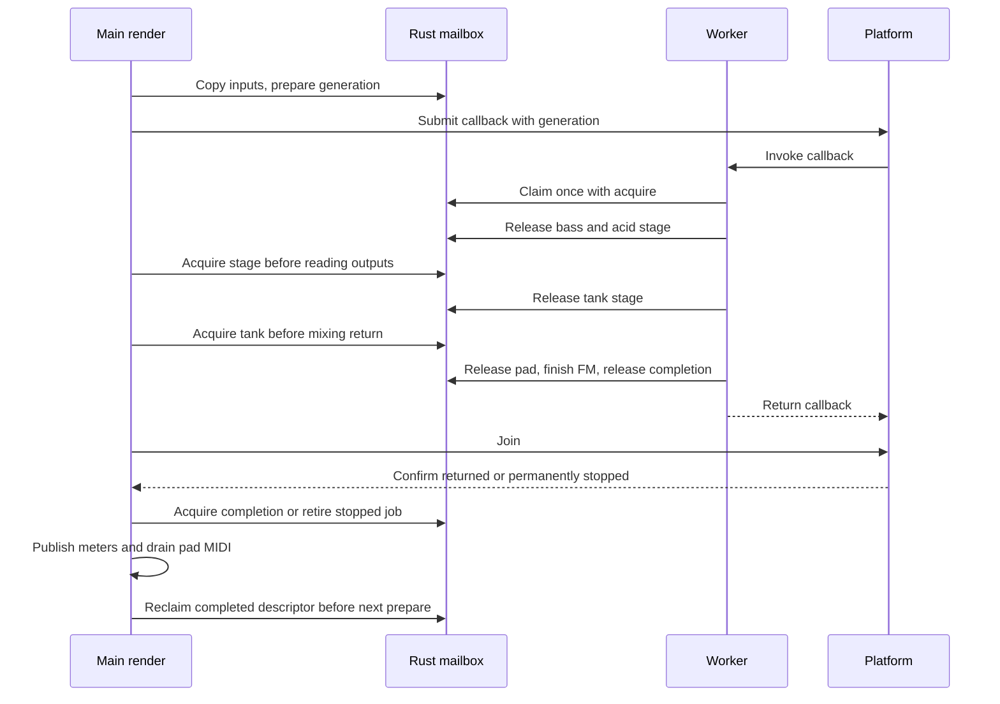

# DSP job lifetime and staged outputs

[R13 / issue #14](https://github.com/superposition/91/issues/14) now has a real
Rust-controlled job boundary behind `EN_RUST_WORKER`. It preserves the retained
worker placements and DSP order: optional bass/acid, reverb tank, pad, FM6.
Physical stop mechanics and the MCU atomic backend remain separately qualified
by the platform work; a timeout alone never releases a DSP buffer.

## Descriptor, stages and ownership

`fm1-rt::job::JobMailbox` owns the copied, immutable 32-byte job descriptor,
generation/state word and stage publication. The descriptor contains frame
count, predelay read position, FM enable, FM/pad write positions, bass placement,
genre and integer/float FM selection. The last two values are snapshots because
their public UI setters are immediate; a check followed by a write would leave
an IRQ window. Other worker configuration inputs are render-owned and remain
unchanged until ownership returns. The worker receives a generation encoded by
value as its opaque callback context, rather than a pointer to an overwritten
future descriptor.

The mailbox occupies 96 bytes, aligned to 32 bytes, with separate control and
stage cache lines. One claim changes Ready to Running and copies the descriptor
after acquire. An unfinished lease's drop leaves Running. Each completed stage
releases only its own outputs after all kernel borrows have ended; the remaining
worker state stays leased. Completion is released after the C callback returns.
Stale generations cannot claim, publish, cancel or reclaim a newer job. A
29-bit generation never wraps: exhaustion retires asynchronous dispatch into
the serial path rather than reusing an old token.



The existing audio arrays and voice/effect state remain in their established
pool/BSS regions. Scoped DSP bridges borrow bounded buffers only while their
stage owns them. The pad/FM FIFOs retain their disjoint producer/consumer spans,
and the tank's predelay reads remain separated from current input writes.
Descriptor synchronization does not create an exclusive reference to a whole
shared ring, and does not by itself own foreign C memory: the reviewed bridge
contracts and confirmed worker lifetime protect that memory.

Thirty-two bytes stage the worker-written pad/bass/acid levels and pad note/amp
fields. Only the joined main owner publishes public UI meters. This matters
when an unconfirmed worker outlives a render call: UI reads do not touch its
private in-progress writes. The original 16-message pad MIDI queue is retained.
Its main producer runs before dispatch; its worker producer runs during the
pad stage. Main now flushes after confirmed join, so those accesses never
overlap. Frozen serial packet/callback ordering is preserved; threaded/deferred
ordering is made deterministic instead of depending on the old queue race.

No allocator or additional audio/voice bank is introduced. The named static
storage delta is 164 bytes: 96-byte mailbox, 32-byte diagnostics and 32-byte
private meters, plus the enlarged C descriptor and two lifetime scalars, less
the three removed volatile stage flags. This is a source-layout count, not a
linked MCU memory map. Existing fixed voice, FIFO, staging and MIDI limits stay
unchanged. Diagnostic indices 56..63 report prepared jobs, claims, released
stages, completions, refused/serial dispatch, retirements, stale operations and
quarantines through the existing statistics export.

## Refusal, loss and unknown ownership

The platform contract is explicit:

| Result | Meaning | Main may do |
| --- | --- | --- |
| submit 0 | No callback was queued or started | Claim that generation inline once |
| join 1 | The callback has returned | Also acquire Rust completion before reuse |
| join 0 | Current execution and all nested DSP callbacks are permanently stopped | Retire that generation, discard results and recover |
| negative join | Execution/ownership is still unknown | Quarantine; write silence only to separate main output |

A stage wait has at most 65,536 polling attempts before calling the platform's
bounded join. A missing stage publication can therefore fall back to a genuine
completed join. A stale backend completion cannot override the Rust generation
and completion checks. Init/attach require serialized boot/no outstanding job;
active-job attempts are rejected. The host-only reseed hook also refuses an
outstanding worker.

While quarantined, render does not consume queued controls, advance musical
state, prepare another job, reset state or borrow worker-owned outputs. It
zeros only the caller's main/USB output spans. A later bounded join must confirm
completion or permanent stop before recovery accesses those buffers. Recovery
discards partial pad MIDI, uses the existing all-notes-off operation so a dropped
note-off cannot leave an external note held, and restores the affected audio
buffers/effects. Permanent retirement disables future asynchronous submissions;
subsequent jobs execute serially. The old job is never replayed over partly
advanced DSP state. Silence/clock freezing and dropped results are explicit
fault behavior, not normal musical timing changes.

The C fallback remains selectable with `EN_RUST_WORKER=0`; its historical
volatile-stage/queue assumptions are not claimed as the new synchronization
proof. The default physical firmware is not enabled merely by a hosted pass.

## Software evidence

Use pinned Rust 1.94.1 and the immutable R01 source checkout:

```sh
RUSTUP_TOOLCHAIN=1.94.1 cargo test -p fm1-rt --locked
RUSTUP_TOOLCHAIN=1.94.1 sh tests/rust_worker_handoff.sh ../baseline-2026-11-11/source
```

The six runtime tests cover one-shot inline dispatch, stale tokens, dropped
leases, quarantined completion, permanent stopped retirement and exhaustion.
One test concurrently publishes 100,000 32-byte descriptors and three separate
output stages, checking every output word after acquire.

The native harness includes actual DSP dispatch, render, MIDI and UI publication
paths. Twenty-four valid cases cover serial/deferred/pthread/busy execution,
missing stage publication and stale callback replay, with both work placements
and legacy/v2 keyboard/bass sources. They compare full PCM, fixed USB output,
MIDI packet/callback order and public-meter bytes against frozen serial C and
fresh serial C0. Twelve fault cases cover loss at bass/tank/pad, unknown ownership
followed by completion or stopped retirement, and a false backend completion.
The tests require silence with bounded main/USB writes, unchanged leased state
and inputs during quarantine, deferred queued controls, and continued serial
DSP after permanent retirement.

Fault tests pause only at a real stage boundary after kernel borrows end, then
request cooperative stop and `pthread_join` before returning stopped. They never
declare a live writer dead. This establishes the software ownership protocol;
it does not claim a physical asynchronous stop inside a DSP instruction.
`worker-handoff-proof.json` records the checkpoint results. Combined regression
and the platform atomic/stop qualification are tracked independently during
integration; remaining physical stack/cache/deadline/link qualification must
not be inferred from the hosted checks.
